<div align="center">
  </picture><br>
</div>

<p align="center">
  An <i>unofficial</i> port of <b>DELTARUNE Chapters 1–5</b> for the PlayStation Vita.
</p>

DeltaruneVita runs the official Windows/Steam GameMaker data through a Vita-focused implementation of [Butterscotch](https://github.com/ButterscotchRunner/Butterscotch), using [VitaGL](https://github.com/Rinnegatamante/vitaGL) for graphics and OpenAL for audio. It adds Vita controls, optional touch input, configurable graphics and audio, console borders, language/mod support, trophies, native video playback, diagnostics, and dedicated patchers that generate the required Vita data from a legally obtained copy of the game.

> [!IMPORTANT]
> This repository and its releases do **not** include DELTARUNE's commercial game data.
> A legitimate Steam copy is required. You can purchase the game at [deltarune.com](https://deltarune.com/).

---

<a id="project-status"></a>

<a href="#project-status">
  
</a>

<div align="center">
  <a href="https://github.com/WolffsRoom/DeltaruneVita/releases"></a>
  <a href="https://github.com/WolffsRoom/DeltaruneVita/releases/latest"></a>
  <br>
  
  
  
</div>

<br>


<table align="center">
  <thead>
    <tr>
      <th align="center">Chapter</th>
      <th align="center">Status</th>
      <th align="center">Details</th>
      <th align="center">Reviewed</th>
    </tr>
  </thead>
  <tbody>
    <tr>
      <td align="center">
        
        <br><b>Chapter 1</b>
      </td>
      <td align="center"><b>Playable</b></td>
      <td align="center">Everything works perfectly.</td>
      <td align="center"><b>100%</b></td>
    </tr>
    <tr>
      <td align="center">
        
        <br><b>Chapter 2</b>
      </td>
      <td align="center"><b>Playable</b></td>
      <td align="center">Minor performance drops in some rooms.</td>
      <td align="center"><b>100%</b></td>
    </tr>
    <tr>
      <td align="center">
        
        <br><b>Chapter 3</b>
      </td>
      <td align="center"><b>Playable</b></td>
      <td align="center">
        Some mini-game rooms lag on first load.<br>
        Generally 30+ FPS afterward. Smooth final battle.
      </td>
      <td align="center"><b>95%</b></td>
    </tr>
    <tr>
      <td align="center">
        
        <br><b>Chapter 4</b>
      </td>
      <td align="center"><b>Playable</b></td>
      <td align="center">
        Some rooms need optimization.<br>
        Choppy climbing sequence, but smooth final battle.
      </td>
      <td align="center"><b>85%</b></td>
    </tr>
    <tr>
      <td align="center">
        
        <br><b>Chapter 5</b>
      </td>
      <td align="center"><b>Experimental</b></td>
      <td align="center">
        Smooth final battle, but optimization is incomplete.<br>
        Possible FPS drops, freezes, and GPU crashes.<br>
        Full completion not yet verified.
      </td>
      <td align="center"><b>80%</b></td>
    </tr>
  </tbody>
</table>

<div align="center">
  <p>
    For release-specific changes, screenshots, and the complete changelog,
    check out the <a href="https://github.com/WolffsRoom/DeltaruneVita/releases/latest"><b>Latest Release</b></a>.
  </p>

  <a id="support-this-and-other-projects"></a>

<a href="#support-this-and-other-projects">
  
</a>

_If you enjoy my work, consider supporting the development!_

[](https://www.buymeacoffee.com/5rsrt7j4z8f)

</div>

---

<a id="installation-guide"></a>

<a href="#installation-guide">
  
</a>

<a id="requirements"></a>

<a href="#requirements">
  
</a>

- A homebrew-enabled PlayStation Vita;
- [kubridge](https://github.com/TheOfficialFloW/kubridge/releases/);
- [FdFix](https://github.com/TheOfficialFloW/FdFix/releases/), unless rePatch already provides equivalent file-descriptor handling;
- `libshacccg.suprx`, installed using the [Vita shader compiler guide](https://samilops2.gitbook.io/vita-troubleshooting-guide/shader-compiler/extract-libshacccg.suprx);
- an official, unmodified **DELTARUNE Steam v0.0.253** installation.

Optional: [PSVshell](https://github.com/Electry/PSVshell/releases) can be used for overclocking. To enable native PS Vita trophies, follow the [NoTrpDrm setup](#native-ps-vita-trophies-with-notrpdrm) below.

Add the required kernel plugins under `*KERNEL` in taiHEN's `config.txt`:

```text
*KERNEL
ux0:tai/kubridge.skprx
ux0:tai/fd_fix.skprx
```

> [!NOTE]
> Do not load `fd_fix.skprx` together with a setup where rePatch already provides the same functionality.

---

<a id="how-to-install-the-game"></a>

<a href="#how-to-install-the-game">
  
</a>

1. Purchase and install [DELTARUNE for PC](https://store.steampowered.com/app/1671210/) through Steam.
2. Confirm that the installation is **v0.0.253** and unmodified.
3. Download `Deltarune-v0.81.vpk` and the patcher for your PC architecture from the [latest release](https://github.com/WolffsRoom/DeltaruneVita/releases/latest).
4. Generate the Vita data using DeltaruneVita Patcher, Seam's Patcher or the Web Patcher.
5. Copy the generated `deltarune` folder to `ux0:data/` on the Vita.
6. Install `Deltarune-v0.81.vpk` using VitaShell.

The final path must be:

```text
ux0:data/deltarune/deltarunevita/
```

---

<a id="deltarunevita-patcher"></a>

<a href="#deltarunevita-patcher">
  
</a>

1. Extract either `Deltarune.Vita.Patcher.v0.81.64bits.zip` or `Deltarune.Vita.Patcher.v0.81.32bits.zip`.
2. Copy the complete Steam `DELTARUNE` folder into `SteamFiles/DELTARUNE`.
3. Run the included `DeltaruneVitaPatcher_*bit.exe`.
4. Select optional language packages when offered.
5. The finished data is written to `VitaFiles/deltarune`.

---

<a id="seams-patcher"></a>

<a href="#seams-patcher">
  
</a>

[Seam's Patcher](https://wolffsroom.github.io/DeltaruneVita/) uses the authentic Seam-shop interface and is available in three forms:

- **Seam's Patcher Lite (Recommended, ~220 MB):** Extract `Seam.s.Patcher.v0.81.64bits.zip` or `32bits.zip` and run `SeamsPatcher_Lite_*bit.exe`. Features the full Edge App mode GUI with all 55 animated borders embedded, downloading only selected translation packs on demand with local caching in `cache/`.
- **Web Patcher (Browser or Mobile):** Run directly in your browser at [wolffsroom.github.io/DeltaruneVita](https://wolffsroom.github.io/DeltaruneVita/) with DEFLATE streaming support and mobile compatibility.

1. Run your chosen Seam's Patcher edition.
2. Select a clean DELTARUNE Steam folder when prompted.
3. Select any optional languages/mods (including Animated Borders and PT-BR v0.81).
4. Generate the Vita package, then copy its `deltarune` folder to `ux0:data/`.

> [!NOTE]
> On iOS/iPadOS, provide the DELTARUNE folder as a **ZIP** when the browser cannot select a directory directly.

---

<a id="control-layout"></a>

<a href="#control-layout">
  
</a>

The layout is based on the official PlayStation-style controls with Vita-specific shortcuts for Game Settings and touch features.

<p align="center">
  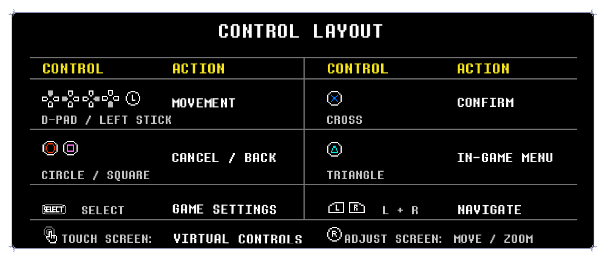
</p>

---

<a id="screenshots-ps-vita"></a>

<a href="#screenshots-ps-vita">
  
</a>
<p align="center">
  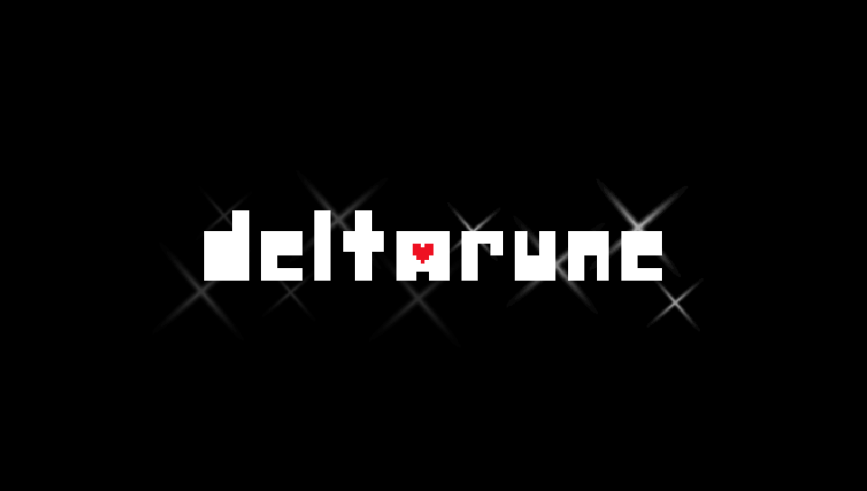
  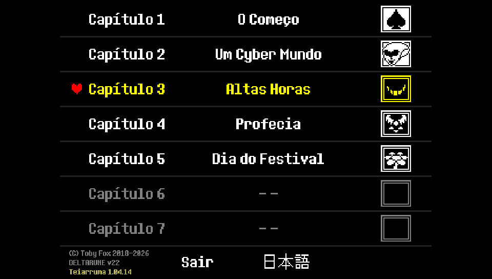
</p>
<p align="center">
  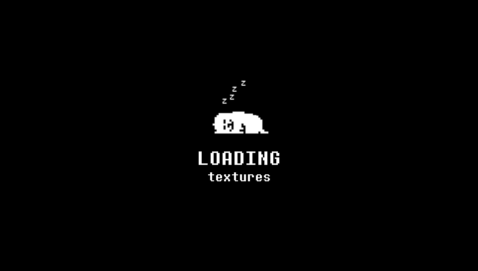
  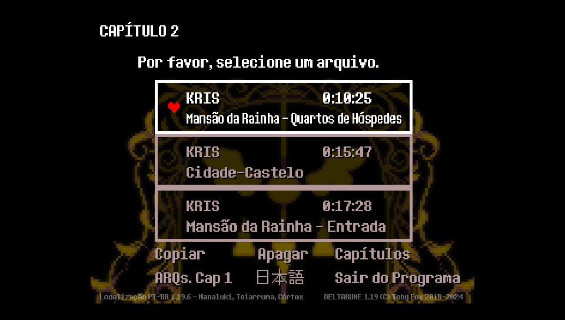
  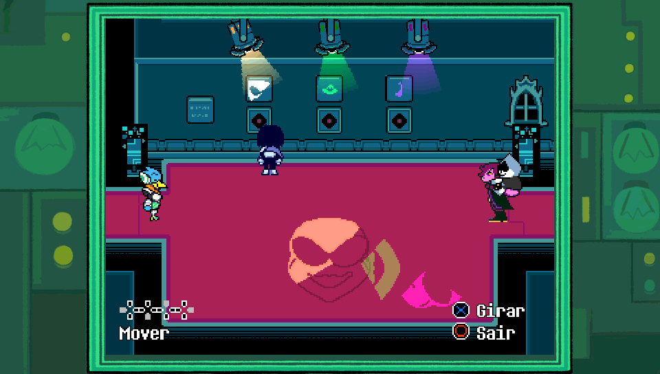
</p>
<p align="center">
  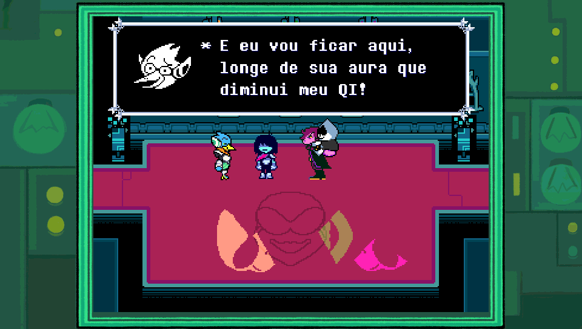
  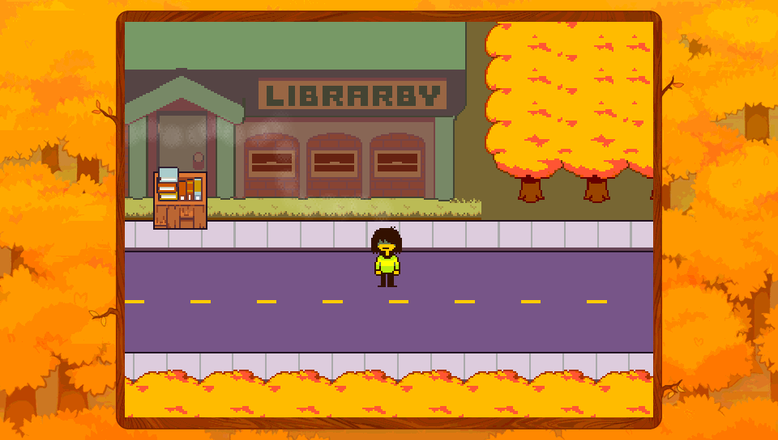
  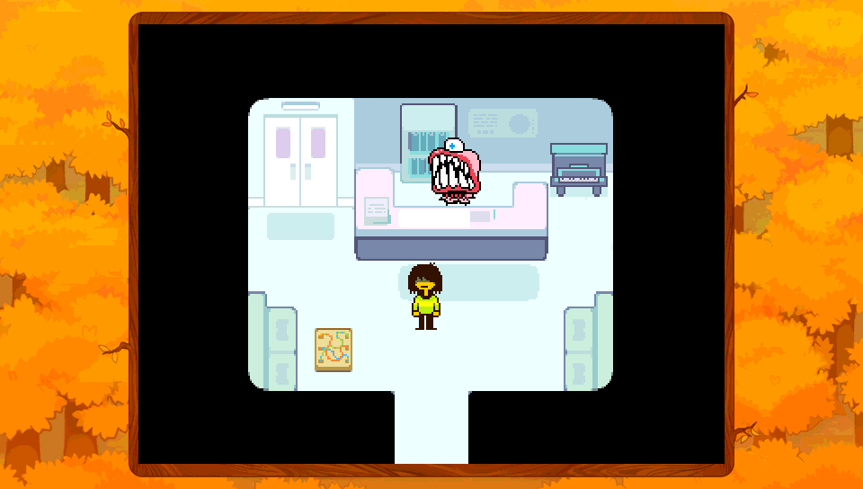
</p>

<a id="game-settings"></a>

<a href="#game-settings">
  
</a>

<p align="center">
  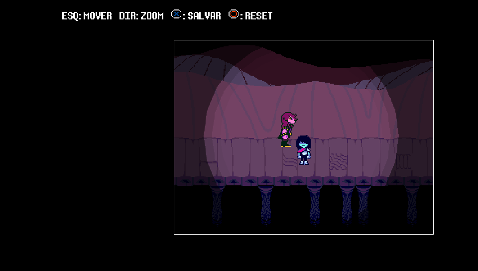
  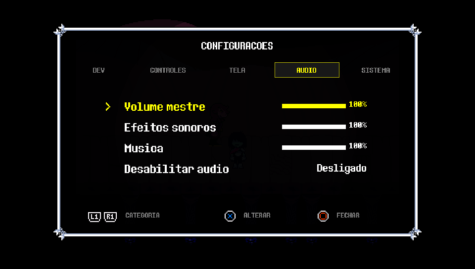
  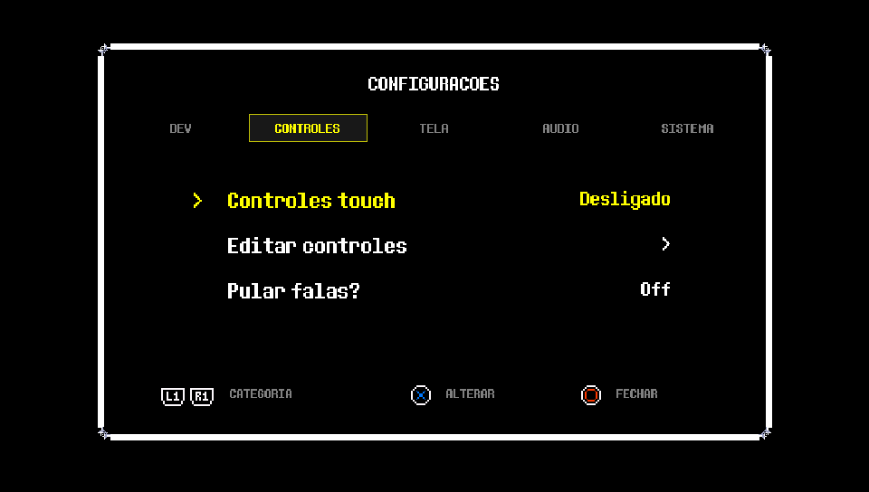
</p>
<p align="center">
  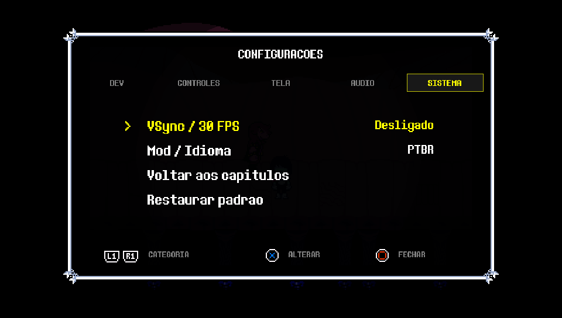
  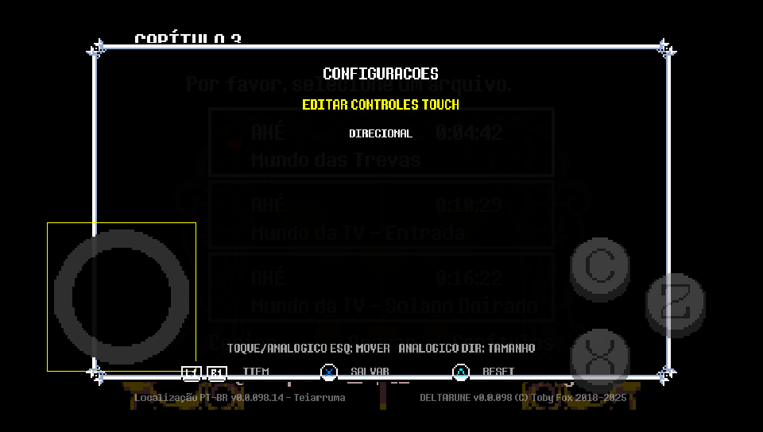
  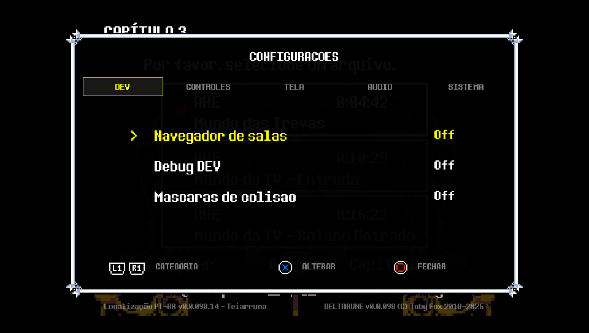
</p>

---

<a id="trophies"></a>

<a href="#trophies">
  
</a>

DeltaruneVita includes a **30-entry trophy system**. Trophy progress is mirrored to the port's local trophy database and can be viewed at **Game Settings → System → Trophies**.

Local progress is stored in:

```text
ux0:data/deltarune_saves/trophies.ini
```

The local trophy interface, unlock notifications and persistence work without any additional plugin. Native PS Vita system trophies are optional.

> [!NOTE]
> DeltaruneVita does not require NoTrpDrm to run. If the plugin, trophy pack or supported native environment is unavailable, the game falls back to the local in-game trophy system.

<a id="native-ps-vita-trophies-with-notrpdrm"></a>

<a href="#native-ps-vita-trophies-with-notrpdrm">
  
</a>

[NoTrpDrm](https://github.com/Rinnegatamante/NoTrpDrm) allows homebrew applications to use trophy packs through `sceNpTrophy` by bypassing the NP Communication and TRP signature checks.

1. Download `NoTrpDrm.suprx` from the [NoTrpDrm Releases](https://github.com/Rinnegatamante/NoTrpDrm/releases).
2. Copy `NoTrpDrm.suprx` to the taiHEN directory used by your Vita. `ur0:tai/` is recommended when `ur0:tai/config.txt` is your active configuration; use `ux0:tai/` only if that is where your active `config.txt` is stored.
3. Add NoTrpDrm under `*main` in the active `config.txt`:

```text
*main
ur0:tai/NoTrpDrm.suprx
```

If your active taiHEN configuration is on `ux0:tai/`, use:

```text
*main
ux0:tai/NoTrpDrm.suprx
```

4. Reboot the Vita or reload the taiHEN configuration.
5. Launch DeltaruneVita. Newly earned trophies will continue to be recorded in `trophies.ini` and, when NoTrpDrm/native trophy initialization is available, will also be mirrored to the Vita trophy system.

> [!IMPORTANT]
> The NoTrpDrm implementation used by this project targets retail firmware **3.60 through 3.68**. Firmware spoofing does not change the console's underlying firmware. Treat this custom trophy set as homebrew/local data and do not attempt to synchronize it with PSN.

---

<a id="what-already-works"></a>

<a href="#what-already-works">
  
</a>

<table>
  <thead>
    <tr><th width="50%">Core Features</th><th width="50%">System and Graphics</th></tr>
  </thead>
  <tbody>
    <tr><td>• Chapter selector for all five chapters</td><td>• Dual Graphics API: VitaGL (Experimental, Legacy, Modern) and native VitaGXM</td></tr>
    <tr><td>• Direct loading of official Steam GameMaker data</td><td>• Hardware VSync at locked 30 FPS synchronized to display VBlank</td></tr>
    <tr><td>• Physical Vita controls and optional touch controls</td><td>• Native C fastpaths for heavy rooms in Chapters 4 & 5 (saving up to 35 ms/frame)</td></tr>
    <tr><td>• Chapter 4 Mike's Room mouse simulation (right stick/touch) & mic input</td><td>• Animated Borders mod with 24 px feathering and &lt; 768 KiB VRAM footprint</td></tr>
    <tr><td>• Vita-native Game Settings menu & enhanced DEV tools</td><td>• New CRT filter suite (Soft, Medium, Aggressive) and display filters</td></tr>
    <tr><td>• Independent volume controls and streamed music</td><td>• Authentic Chapter 5 diagonal petal transition (<code>shd_petalcut</code>)</td></tr>
    <tr><td>• Language/mod packages with isolated data/cache layouts (PT-BR v0.81)</td><td>• Room-aware Texture Page loading, cache and eviction</td></tr>
    <tr><td>• Local and native trophy integration (NoTrpDrm)</td><td>• Native SceAvPlayer video playback & universal cold-boot audio</td></tr>
    <tr><td>• Interactive Prologue with plugin detection (NoTrpDrm / CapUnlocker)</td><td>• Official DualShock 4 / PS4 button glyphs in menus and battle prompts</td></tr>
  </tbody>
</table>

---

<a id="texture-compression-and-external-assets"></a>

<a href="#texture-compression-and-external-assets">
  
</a>

A 2048×2048 GameMaker atlas stored as RGBA8888 occupies 16 MiB of raw texture memory. DeltaruneVita reduces pressure by using rebuilt Texture Pages and prepared GPU-friendly caches:

- **BC3/DXT5:** approximately 4 MiB for a 2048×2048 atlas, including alpha;
- **RGBA4444:** approximately 8 MiB and used where the higher-fidelity prepared path is safer;
- **embedded game texture:** source/fallback used for cache generation and compatibility.

The runner resolves prepared textures in this order:

```text
BC3 → RGBA4444 → generated/embedded compatibility path
```

Language packages keep their own matching caches whenever their `data.win` changes Texture Page contents or indices.

<a id="rebuilt-texture-page-reference-totals"></a>

<a href="#rebuilt-texture-page-reference-totals">
  
</a>

| Chapter | Rebuilt pages |
| --- | ---: |
| Chapter 1 | 192 |
| Chapter 2 | 414 |
| Chapter 3 | 397 |
| Chapter 4 | 838 |
| Chapter 5 | 1,017 |

The higher page count is intentional: smaller, more targeted pages can produce a lower per-room working set than a few oversized atlases.

---

<a id="folder-structure"></a>

<a href="#folder-structure">
  
</a>

<a id="game-data"></a>

<a href="#game-data">
  
</a>

A v0.81 patcher generates the following base layout:

```text
ux0:data/deltarune/
├── config.ini
└── deltarunevita/
    ├── borders/                      # static console border assets
    ├── chapter0/
    ├── chapter1/
    ├── chapter2/
    ├── chapter3/
    ├── chapter4/
    ├── chapter5/
    ├── mods/
    │   ├── bordersanim/              # animated borders (.bani) assets
    │   ├── Borders/                  # Standard borders assets
    │   └── Lang/
    │       └── <Language>/           # isolated translation/mod data
    ├── music/                        # external/shared music assets
    ├── sounds/                       # Vita/frontend sound assets
    ├── ui/                           # Vita-native interface assets
    ├── vid/                          # shared/native MP4 assets
    ├── first_load.mp4                # first-launch video
    └── patcher-report.json           # generation report
```

Each chapter can contain its own GameMaker data and prepared texture assets. For example:

```text
chapter3/
├── data.win
├── lang/
├── pvr/                              # validated BC3/DXT5 prepared pages
├── texture-cache/                    # RGBA4444/other prepared cache pages
├── vid/                              # chapter-local video files, when required
├── texture_manifest.json
└── ...                               # chapter-specific audio/configuration assets
```

Language/mod packages mirror only the paths they replace under `mods/Lang/<Language>/`. See [Mods and Language Packs](#mods-and-language-packs) for a complete example.

---

<a id="save-and-trophy-data"></a>

<a href="#save-and-trophy-data">
  
</a>

Save data is kept separately so replacing/regenerating `ux0:data/deltarune/` does not require deleting normal progress:

```text
ux0:data/deltarune_saves/
├── trophies.ini                      # DeltaruneVita local trophy progress
├── true_config.ini                   # when created by the game/runtime
├── dr.ini                            # when created by the game/runtime
└── DLTR00000/                        # chapter/save data created by the game
    └── ...
```

Actual save files vary according to the chapters/slots that have been used.

<a id="logs-and-diagnostics"></a>

<a href="#logs-and-diagnostics">
  
</a>

When Dev Mode logging is enabled, the primary diagnostic log is:

```text
ux0:data/deltarune/deltarunevita/butterscotch-probe.log
```

When reporting a reproducible issue, include the relevant log together with the Chapter/Room, selected language, renderer, texture-compression mode, FPS limit and a screenshot/video when applicable.

---

<a id="known-issues"></a>

<a href="#known-issues">
  
</a>

- Chapter 3's heaviest TV/video/battle transitions can still expose first-use frame drops or memory pressure.
- Chapter 4 and 5's heaviest battle scenes remain under observation for memory pressure.

---

<a id="building-from-source"></a>

<a href="#building-from-source">
  
</a>

---

<a id="requirements-1"></a>

<a href="#requirements-1">
  
</a>

- Windows 10 or 11;
- PowerShell 5.1 or newer;
- Docker Desktop with Linux containers enabled;
- Git with submodule support;
- an official and unmodified DELTARUNE Steam installation.

Prepare the game data:

```powershell
powershell -ExecutionPolicy Bypass -File .\scripts\prepare-windows-data.ps1
```

Build the VPK using VitaSDK through Docker:

```powershell
powershell -ExecutionPolicy Bypass -File .\scripts\build-butterscotch-probe.ps1
```

Build the Windows patchers from:

```text
artifacts/Patcher/Build_Patch/Build_Patcher.bat
```

> [!IMPORTANT]
> Commercial DELTARUNE files must never be committed or redistributed. Releases should contain only the VPK, legal patch data/tools and user-generated output instructions.

---

<a id="butterscotch--vitagl-how-it-works"></a>

<a href="#butterscotch--vitagl-how-it-works">
  
</a>

DELTARUNE Vita does not emulate Windows and does not execute the original PC executable. It reads the official GameMaker data and runs it through a customized native runner:

```text
Official Steam files
        ↓
Per-chapter data.win
        ↓
Customized Butterscotch runner
        ↓
GameMaker rooms, objects, scripts and events
        ↓
VitaGL + OpenAL + Vita platform services
        ↓
PS Vita display, audio, controls and storage
```

The Vita-specific layer provides Game Settings, physical/touch input, console borders, native video, trophies, loading/cache screens and diagnostics without replacing the game's normal GameMaker logic.

---

<a id="mods-and-language-packs"></a>

<a href="#mods-and-language-packs">
  
</a>

DeltaruneVita supports alternate game data and external assets through the `deltarunevita/mods` tree. In v0.81, this includes both the **language-pack pipeline** and the **Animated Borders mod**:

- **Animated Borders Mod (`mods/bordersanim/`):** A PS Vita-exclusive mod providing smooth animated side strips (`frames_side.bani`) for 55 rooms, featuring a 24-pixel linear transparency gradient (feathering) over the static full-screen border with minimal memory footprint (&lt; 768 KiB VRAM).
- **Language Packs (`mods/Lang/`):** English and the game's native Japanese mode use the original data. Optional v0.81 language packages are available for:
  - Portuguese (Brazil) — updated with Chapter 5 translation by TEIARRUMA
  - Spanish
  - French
  - German
  - Russian
  - Turkish

Both DeltaruneVita Patcher and Seam's Patcher use the same language catalog and validate downloaded packages by **file size and SHA-256** before applying them. The packages are kept separate from the GitHub Release assets and are served through the project's `gh-pages` catalog.

> [!IMPORTANT]
> A translated `data.win` can have a different Texture Page layout from the original game. Keep each translation together with its matching v0.81 texture cache. Do not copy an original-language cache over a translated chapter unless its TXTR layout is known to match.

---

<a id="languagemod-folder-layout"></a>

<a href="#languagemod-folder-layout">
  
</a>

Language packages are installed under:

```text
ux0:data/deltarune/deltarunevita/mods/Lang/<Language>/
```

A language only needs to contain the chapters/assets that it overrides. A representative package can look like this:

```text
mods/
├── bordersanim/                          # animated border frames (.bani)
└── Lang/
    └── Portuguese-BR/
        ├── chapter1/
        │   ├── data.win                  # translated GameMaker data, when replaced
        │   ├── lang/                     # chapter-local string assets, when used
        │   ├── pvr/                      # prepared BC3/DXT5 pages
        │   ├── texture-cache/            # prepared RGBA4444/cache pages
        │   └── texture_manifest.json     # cache/TXTR metadata
        ├── chapter2/
        │   ├── data.win
        │   ├── pvr/
        │   ├── texture-cache/
        │   └── texture_manifest.json
        ├── chapter3/
        │   ├── data.win
        │   ├── pvr/
        │   ├── texture-cache/
        │   ├── vid/                      # language-specific videos, when supplied
        │   └── texture_manifest.json
        ├── chapter4/
        ├── chapter5/
        ├── lang/                         # package-wide language assets, if required
        └── music/                        # language/mod-specific music overrides, if required
```

The exact contents differ between translations. Some packages replace a full `data.win`; others provide strings, music, video or selected chapter assets. The patchers preserve this per-language separation so incompatible atlas indices and caches are not mixed.

For development/preparation work, source translations can be staged under `data/prepared/deltarune/deltarunevita/mods/Lang/<Language>` and processed with the project's preparation scripts. End users should normally let a v0.81 patcher install the matching language package automatically.

---

<a id="recent-changelog"></a>

<a href="#recent-changelog">
  
</a>

| Version | Key changes |
| --- | --- |
| **v0.69** | Adopted validated BC3/DXT5 prepared pages, improved room/audio transitions, fixed multiple Chapter 2/3/5 softlocks/crashes, compressed borders and introduced broader language-pack support. |
| **v0.70** | Added the trophy system and initial 60 FPS compatibility work, corrected Spanish language handling and expanded PT-BR atlas optimization. |
| **v0.71** | Introduced the room-aware Texture Page rebuild, DeltaCache-based prepared pipeline, local BC3 fallback generation, expanded Game Settings and additional rendering/audio/memory fixes. |
| **v0.72** | Added the native `SceAvPlayer` video backend, embedded first-launch video, further translation compatibility and Chapter 3/5 video/memory work. |
| **v0.73** | Public release consolidating v0.70-v0.72 work with DeltaRepack + DeltaCache, the optional loading mini-game, updated patchers/language packs, trophy refinements, room-aware memory improvements, native video/audio fixes and broader Chapter 3/5 stabilization. |
| **v0.80** | Major architectural milestone introducing the native VitaGXM (`libgxm`) renderer backend, rewritten Texture Page pipeline, memory management overhaul and initial C engine fastpaths. |
| **v0.81** | Hardware VSync at locked 30 FPS (eliminating the 15 FPS pacer delay), native C fastpaths for Chapters 4 & 5 (`floortex`, cliffs, tower), animated borders mod with feathering, Soft/Medium/Aggressive CRT filters, Mike mouse & mic controls (Ch4), resolved duplicate TP bar & diagonal petal transition (Ch5), interactive Prologue, DualShock 4 glyphs, and new Seam's Patcher Lite/Offline. |

For the development history and individual internal builds, see `docs/` and the repository's [Releases](https://github.com/WolffsRoom/DeltaruneVita/releases).

---

<a id="development-tools-and-references"></a>

<a href="#development-tools-and-references">
  
</a>

- [Butterscotch](https://github.com/ButterscotchRunner/Butterscotch) — open-source GameMaker runner used as the foundation of the port.
- [VitaGL](https://github.com/Rinnegatamante/vitaGL) — hardware-accelerated rendering on PS Vita.
- [VitaSDK](https://vitasdk.org/) — Vita homebrew toolchain.
- [UndertaleModTool](https://github.com/UnderminersTeam/UndertaleModTool) — GameMaker data inspection, patching and validation.
- [Butterscotch DataWin](https://github.com/ButterscotchRunner/DataWin) — GameMaker data-format reference.
- [FFmpeg](https://github.com/FFmpeg/FFmpeg) — media inspection/conversion during development.
- [PVRTexTool](https://developer.imaginationtech.com/downloads/) — texture-format preparation and validation.
- [PSDevWiki](https://www.psdevwiki.com/vita/) — Vita platform documentation.

---

<a id="credits"></a>

<a href="#credits">
  
</a>

- **DELTARUNE** by Toby Fox and the DELTARUNE team — [official website](https://deltarune.com/).
- [Butterscotch](https://github.com/ButterscotchRunner/Butterscotch) and its contributors.
- [VitaGL](https://github.com/Rinnegatamante/vitaGL) by Rinnegatamante.
- [VitaSDK](https://vitasdk.org/) and the PlayStation Vita homebrew community.
- [DELTARUNE PT-BR Translation](https://github.com/teiarruma/deltarune-ptbr) by TEIARRUMA and contributors.
- Community localization teams responsible for the optional language packages.
- Niccbilac for additional controller artwork used by Game Settings.
- MrPowerGamerBR for technical references shared with the GameMaker porting community.

---

<a id="ai-notice"></a>

<a href="#ai-notice">
  
</a>

GPT-5.6 Sol through Codex was used as a development assistant for diagnostics, implementation support, project organization and technical documentation. Gemini was used during development of Seam's Patcher. All changes remain subject to project review and real-hardware testing.

---

<a id="license-and-game-data"></a>

<a href="#license-and-game-data">
  
</a>

Butterscotch is distributed under the Mozilla Public License 2.0. Modified MPL-covered source files in this project remain available under the same license, with their copyright and license notices preserved. See [LICENSE](LICENSE) and the corresponding source files for details.

DELTARUNE, its characters, music and assets belong to their respective owners. This project does not distribute the commercial files required to play the game.

<p align="center">
  
</p>

<p align="center">
  <sub>
    DELTARUNE © Toby Fox 2018–2026. All rights reserved.<br>
    Steam and the Steam logo are trademarks and/or registered trademarks of Valve Corporation.<br>
    PlayStation and the PlayStation family marks are trademarks of Sony Interactive Entertainment LLC.
  </sub>
</p>
