# Public Release v0.80

  

Hey everyone! Wolff here again!

After months of experiments, internal builds, performance profiling, GPU crashes, shaders, and a ridiculous number of debug logs, **DELTARUNE for PS Vita v0.80** brings together everything developed since the public **v0.73** release.

This is not just a bug-fix update. It's a major overhaul of the graphics architecture, rendering compatibility, loading, memory management, chapter-specific behavior, and presentation — including the introduction of **Native GXM**.

**This release consolidates the v0.74, v0.75, v0.76, v0.77, v0.78 and v0.79 development cycles, plus the subsequent v0.79.x internal fixes.** Features already carried forward are documented once below rather than repeated by build.

> [!IMPORTANT]
> This is a major graphics transition. Native GXM is still experimental and may have differences from VitaGL, including missing effects, FPS drops, or progression bugs. Keep compatible prepared game data and back up your saves.
>
> The PS Vita VPK does **not** include the full official DELTARUNE game. Your own legally obtained game data is required.

  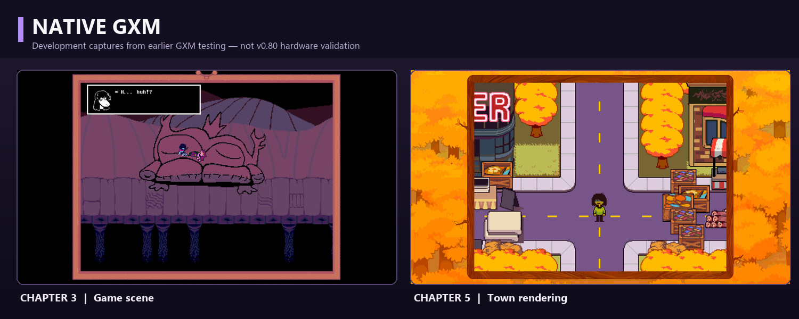
   
  <em>Real Vita3K captures from the Native GXM development process. These are not a claim of final v0.80 gameplay validation.</em>

## Main Changes

### 1. Native GXM — a new rendering backend

**Native GXM** uses the Vita's `sceGxm` API and embedded GXP shaders, allowing more direct control over the GPU without the VitaGL translation layer.

- Added an independent Native GXM executable inside the unified VPK alongside VitaGL.
- Added a lightweight backend launcher and a selectable graphics API, with fallback to VitaGL when GXM fails to boot.
- Integrated Butterscotch's GameMaker parser, VM, rooms, draw events, surfaces, bitmap fonts, textures, audio, and chapter switching into the new rendering path.
- Implemented GameMaker-style draw primitives, colored/textured geometry, vertex buffers and surface composition.
- Corrected RGBA4444 channel/layout issues that caused pink or blue textures.
- Implemented or improved native GXP paths for grayscale photographs, lighting, garden petals, screen blending, transparency, depth/tower effects, and more.
- Improved offscreen targets, transform isolation, camera handling, surface snapshots, alpha operations and depth-sensitive rendering.
- Expanded support for per-room compatibility rules previously used only by VitaGL.
- Kept unsupported effects on guarded fallback paths instead of deliberately crashing the game.

VitaGL remains included. Its **Automatic**, **Legacy-GL**, **Modern-GL** and **Experimental-GL** modes are still useful for testing and comparison.

> [!NOTE]
> Native GXM is a big architectural milestone, **not** a promise of full shader parity or 60 FPS everywhere. Some native shader conversions and Chapter 5 effects still need testing on real hardware.

### 2. GPU stability, memory and crash prevention

A huge amount of work was dedicated to graphics resource lifetime and GPU crashes.

- Fixed premature disposal of textures/surfaces after NanoVG flushes: GPU resources are now retired according to presented frames rather than assuming a flush means the GPU finished sampling.
- Improved synchronization at room changes and cleanup boundaries.
- Added guarded shader-uniform reservations; invalid or failed GPU allocations are rejected instead of submitted.
- Disabled the problematic Modern-GL VAO path on Vita to avoid referencing recycled graphics state.
- Added protection against self-intersecting quads and malformed primitives.
- Expanded Native GXM surface handling, including larger offscreen surfaces.
- Increased Native GXM stack/heap headroom for deeply nested GML events and heavy resource workloads.
- Improved frame-boundary eviction, resident texture pages, safe disposal and memory telemetry.
- Reduced redundant full-GPU synchronization after BC3 uploads while preserving barriers where necessary.
- Made room navigation and heavy transitions trim stale texture/CPU working sets.

**Many previously reproducible GPU crash paths have been addressed.** I cannot promise that GPU crashes are gone forever. (Believe me, I would love to.)

### 3. Texture pipeline — DeltaRepack, DeltaCache and RGBA4444

The texture system introduced in v0.73 remains central to v0.80, with substantial additional refinements.

- Maintained the room-aware DeltaRepack texture-page layout and the DeltaCache preparation workflow.
- Added/expanded direct **BC3/DXT5** texture uploads in compatible VitaGL paths.
- Kept fonts, interface elements and other sensitive textures on lossless-compatible paths.
- Expanded **RGBA4444** support and corrected channel ordering in Native GXM.
- Reused prepared `.r444` caches in Native GXM, with first-run cache generation when needed.
- Added cache completion markers and reduced repeated scanning, parsing and uploads.
- Improved separate language/cache handling when translated `data.win` files use different texture layouts.
- Improved atlas residency, preload policy and protection against resource eviction loops.
- Added memory budget adjustments for particularly expensive Chapter 3 and Chapter 5 scenes.

  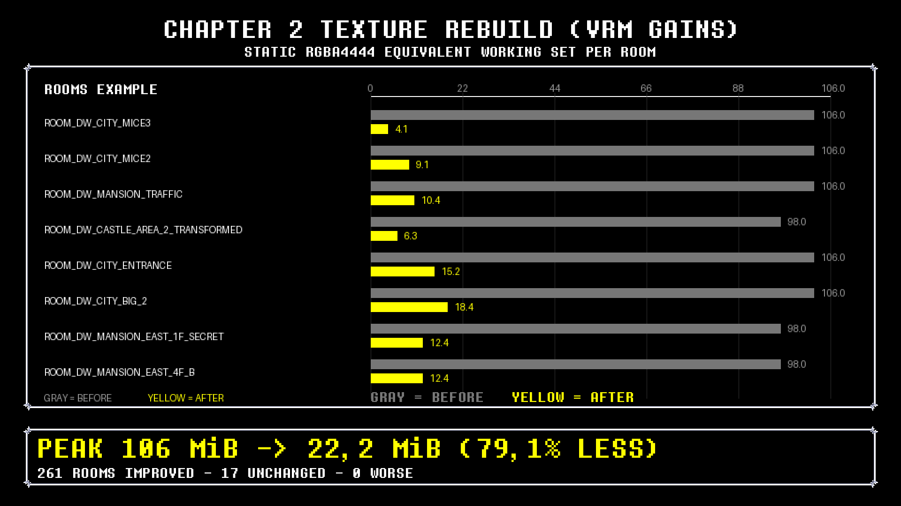
  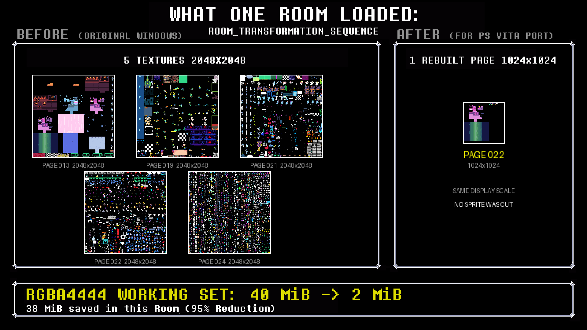

<em>Graphics and texture configuration introduced in the v0.73 pipeline and expanded in subsequent builds.</em>

### 4. Loading, prefetching and frame pacing

Loading and transition delays have been a major focus from v0.75 onward.

- Improved early loading screens and progress reporting before large parsing operations.
- Added the ability to parse Chapter 0 game data while the opening video is playing, with synchronous fallback on failure.
- Added bounded background preparation of room payloads and texture data; GPU uploads still run on the main thread.
- Limited CPU staging work and memory to avoid destabilizing the renderer.
- Improved 30/40 FPS scheduling using absolute deadlines and adaptive waiting.
- Prevented late frames from causing unnecessary extra waits or immediate catch-up frames.
- Reduced expensive scene restarts and synchronization between surface passes.
- Improved prewarming of common battle assets and reduced first-use texture/audio stalls.
- Improved Chapter 3 minigame and Chapter 5 room-transition memory handling.
- Added timing logs for chapter loading, room entry, first rendered frame, texture uploads and long stalls.

The first visit to a complex room can still be slower than subsequent visits.

  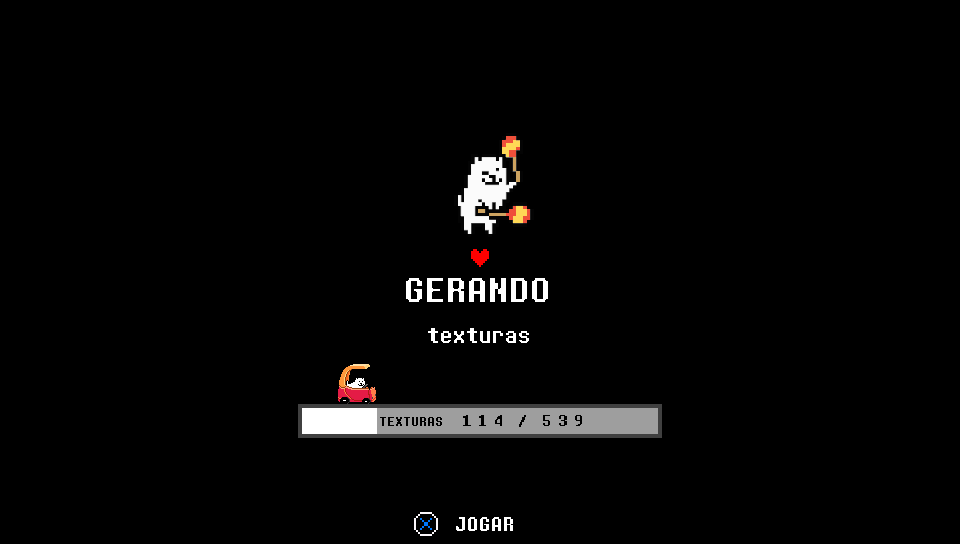

<em>The texture-generation screen and its optional mini-game remain part of the Vita loading experience.</em>

  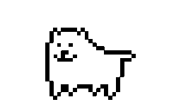
  
  
  

### 5. New introduction and a little surprise

New players have a new way to begin their journey.

- Prepared a new **18-second opening video**, encoded for PS Vita hardware playback.
- Improved video frame retention, fade-out, decoder-buffer handling and startup transitions.
- Kept game-data preloading separate from video decoding where possible.
- Updated the LiveArea visuals with new background, icon and startup artwork.

  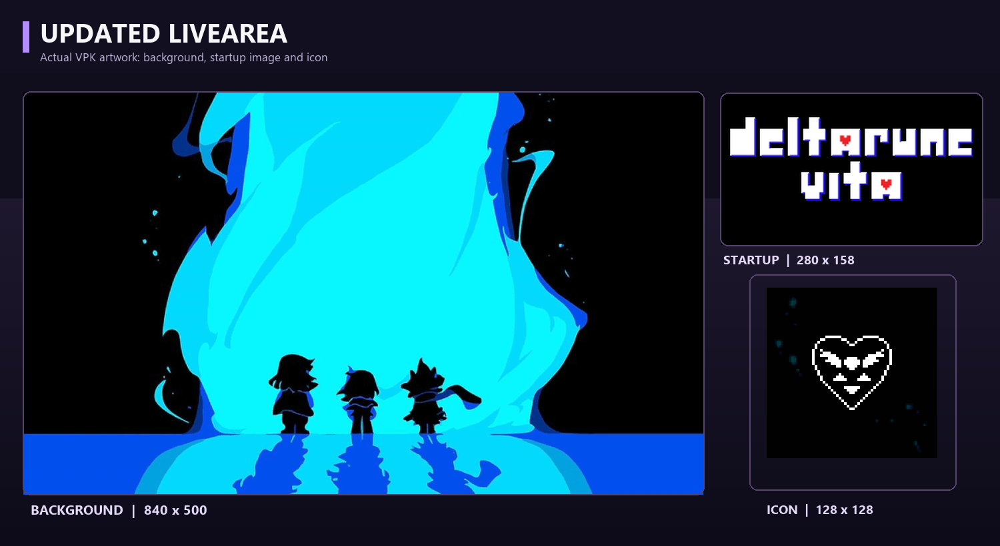
   
  <em>Actual new LiveArea assets used in the VPK.</em>

  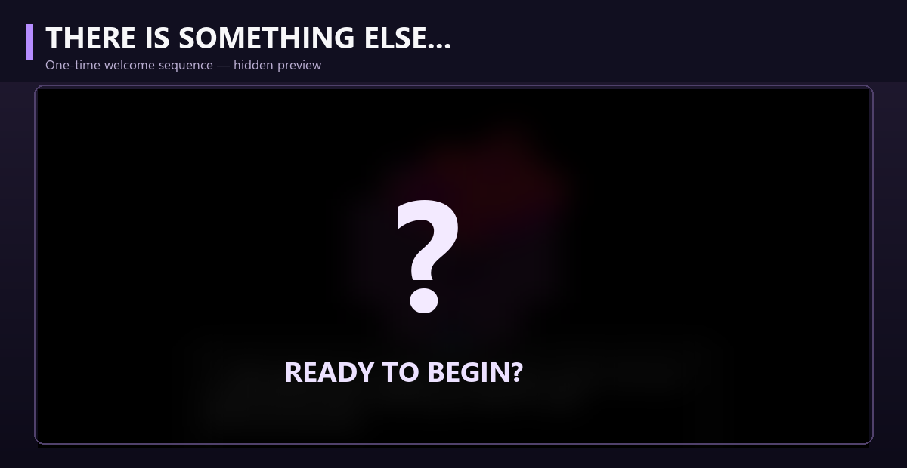

**Two surprises:**

1. A new opening.
2. ...?

I won't spoil the second one. :)

The one-time interactive welcome sequence began on Native GXM and was later implemented in VitaGL as well (v0.80-26 onward).

> [!WARNING]
> **Release-packaging check:** the 18-second source video exists in the project, but the latest inspected prepared/Patcher `first_load.mp4` was still 4.5 seconds. Synchronize the patcher/data bundle before advertising the 18-second video as included for every player.

### 6. Native video, audio and dialogue

- Continued improving the SceAvPlayer path for GameMaker video events.
- Improved native video decoding, frame pacing, orientation and player shutdown.
- Improved audio handoff around video playback and room transitions.
- Preserved safe teardown order for video-audio workers to avoid post-video crashes.
- Improved OGG streaming, buffer reuse and track transitions.
- Reduced redundant monitor copies in selected video-heavy Chapter 3 scenes.
- Corrected dialogue line spacing, carriage returns, ascender offsets and bitmap glyph positioning.
- Fixed the last-pixel-row clipping affecting battle-dialogue characters across chapters.
- Replaced synthetic accent marks with extended full glyphs, improving translated text.
- Corrected photograph surface-copy coordinates and related grayscale effects.

### 7. Game Settings, borders, controls and tools

- Retained **Automatic**, **Legacy-GL**, **Modern-GL** and **Experimental-GL** graphics choices in VitaGL; added Native GXM as a separate backend.
- Added safer shader fallbacks and more detailed graphics-mode explanations.
- Improved the loading-screen graphics-state reset when toggling shader options.
- Expanded resolution/texture profiles, 30/40/60/unlocked FPS policies, screen filters and audio settings.
- Preserved **Scanlines**, **Sharp Bilinear**, **Dithering** and **VHS** effects.
- Adjusted menu scaling and corrected UI/font sizing in several settings views.
- Improved dynamic border mappings, mirrored corners, fades, and transitions to black.
- Improved border behavior on Game Over, chapter selection, Castle Town doors, the school entrance and Chapter 3 TV sequences.
- Added/integrated PlayStation button prompts, left-stick input, touch configuration, Room Navigator and Dev Mode tools.
- Added object collision masks, screenshot/capture diagnostics, detailed chapter logs, stall detection, memory statistics and log archives.
- Kept the 30-trophy internal system and supported native PS Vita trophies where the required environment is available.

  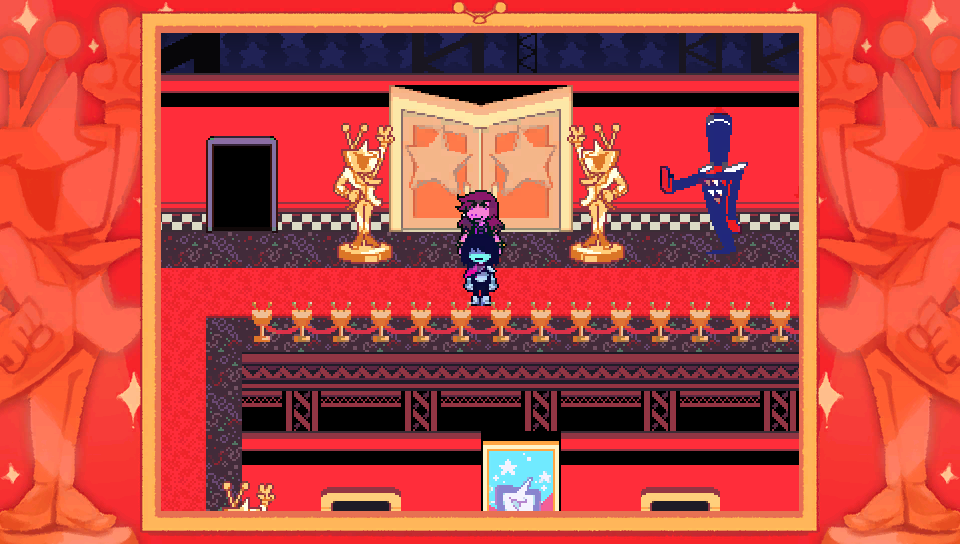
  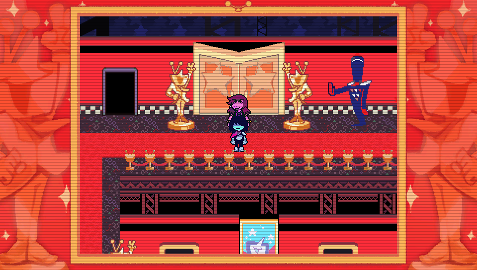
  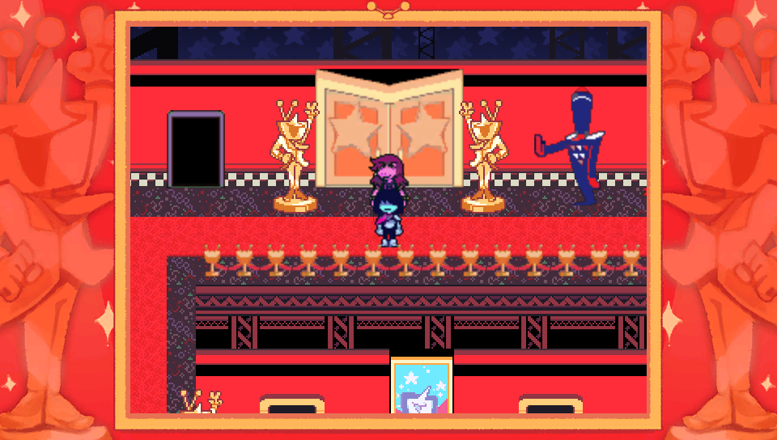

  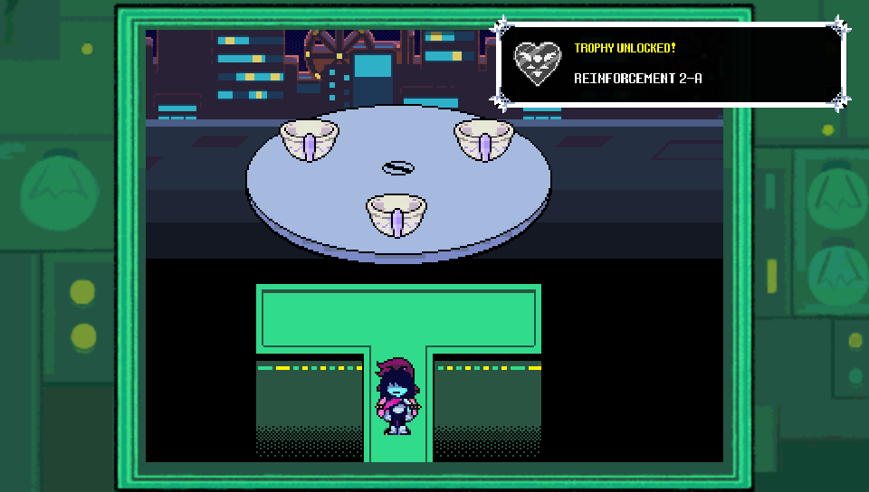
  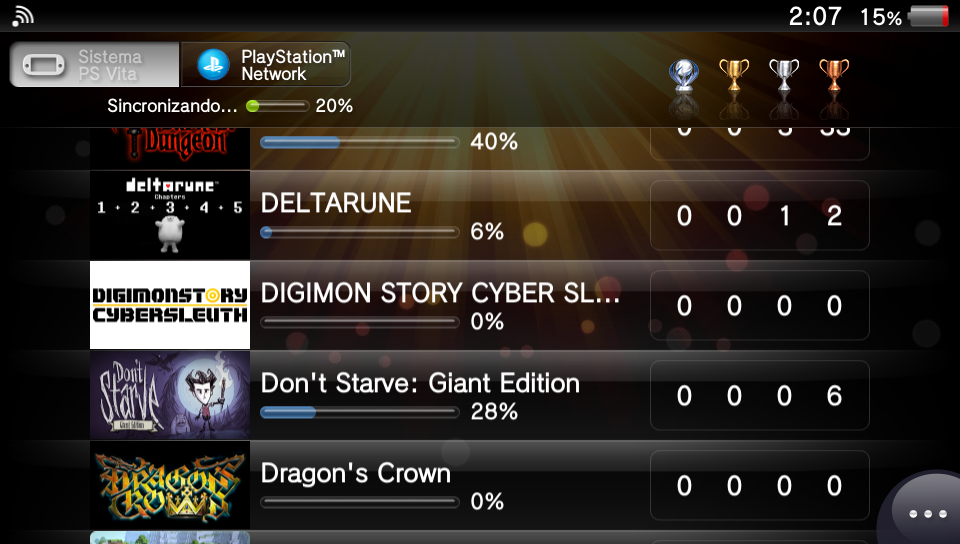

### Superseded and removed experimental behavior

The changelog above reflects the **current** implementation, not every abandoned experiment:

- The old synthetic accent-mark overlay has been replaced by full extended glyphs.
- The outdated LiveArea \`pic0\` overlay is no longer bundled.
- The unstable Modern-GL VAO path has been disabled in favor of safer draw state handling.
- Per-upload full-GPU BC3 synchronization was reduced in favor of targeted safe barriers.
- Previous temporary decoder and shader workarounds have been superseded by the current native video and GXP paths where supported.

## Chapter-by-Chapter Improvements

### Chapter 1

- Improved dialogue, bitmap fonts, text clipping and accented glyph rendering.
- Improved initial battle asset preparation and related first-use stalls.
- Added diagnostic work for cases where music does not resume correctly after battles.
- Preserved the original chapter and translation data paths alongside the new optional startup welcome scene.

### Chapter 2

- Improved Mansion transitions by reserving large-surface memory and trimming resources before heavy room changes.
- Improved shader and texture residency handling.
- Added safer border transitions and cleanup behavior.
- Preserved crash mitigations for heavy battle scenes, including previously reported border-related cases.

### Chapter 3

- Improved gameshow/ranking hub rendering and the performance of several minigames.
- Adjusted TV monitor composition, quiz colors, centered layouts and rhythm-game timing.
- Improved input/audio-clock synchronization for rhythm gameplay.
- Improved Round 2 transitions, grayscale photograph effects and loading.
- Adjusted Tenna cutscene layering, borders, transparency and special attack effects.
- Improved battle entry/prewarming and some game-over/retry paths.
- Added safeguards for the second Roaring Knight failure dialogue, and further work on Knight attack geometry/vertex buffers.
- Reduced or avoided a number of older draw-operation crashes in Native GXM.

  

### Chapter 4

- Improved certain fountain and castle border transitions.
- Expanded shader and memory policies for heavy rooms.
- Worked on the Noelle/Dess room black-screen issue by adjusting destination-alpha composition.
- Added left analog, front touchscreen and click input handling for Mike's mouse-based sequence.
- Adjusted the missing Prophecy text/image masks.
- Improved rendering of primitive-based attack geometry and instrumentation for Knight encounters.
- Continued adjusting Castle Town's initial loading and performance behavior.

> [!NOTE]
> The newest Mike, Prophecy, Noelle/Dess and Knight changes are **implemented but not yet fully verified in their real gameplay sequences**. Please continue reporting any progression blockers.

### Chapter 5

- Improved Town lighting, shadow shader support and the shadow surface/compositing path.
- Addressed incomplete shadow masks, camera transforms and stale shadows across room transitions.
- Improved Castle Town memory/resource behavior and loading.
- Added a reduced-cost profile for moving cliff parallax layers.
- Optimized expensive final-battle surfaces, tower layers and their update cadence.
- Adapted additional tower/depth, Garden petal and screen-blend shaders.
- Corrected full-surface drawing cases that could hide the Flowey tower.
- Improved Flowey video sizing, frame handling and render transitions.
- Adjusted the Garden petals/border fade, duplicated TP presentation and several special battle effects.
- Added more memory diagnostics for the final battle and other demanding rooms.

  <table>
    <tr><th>Modern-GL — shaders disabled (v0.74 capture)</th><th>Modern-GL — shaders enabled (v0.74 capture)</th></tr>
    <tr>
      <td></td>
      <td></td>
    </tr>
  </table>
  <em>Original v0.74 shader comparison. Native GXM has its own work-in-progress shader implementations.</em>

## Languages & Translations

- Preserved English and Japanese support.
- Continued supporting compatible community translations via separate language data.
- Improved accented fonts, UI scaling, and language-specific texture-cache handling.
- Updated language selection with visual icons.
- Improved fallbacks and logs for unsupported or incompatible files.

Not all third-party mods or translations are guaranteed to work. Some require freshly prepared caches and compatible game data.

[Translation support and discussion — #29](https://github.com/WolffsRoom/DeltaruneVita/issues/29)

## Internal v0.80 builds: technical history (v0.80-1–v0.80-59)

**Scope and evidence:** These entries describe the cumulative implementation across the 59 internal builds that formed the complete v0.80 development cycle. They were reconstructed from the build manifests, source regression tests, change logs and diagnostic reports available in the project. For a concise public-facing edition, see [v0.80-short.md](v0.80-short.md). The cycle concluded with **v0.80-59**, establishing the final baseline for the v0.81 series.

### Build-by-build technical changelog

| Build | Changes and scope |
| --- | --- |
| **v0.80-1** | Default-GXM experiment; boot fallback, microphone calibration, prologue languages, borders and Castle Town warmup. |
| **v0.80-2** | GXM prologue asset packaging, language/visual assets. |
| **v0.80-3** | Prologue fade, settings/modal, screen adjustment, Mike mouse/touch and wall texture changes. |
| **v0.80-4** | Language-first typewriter prologue, restartable shader setting, Chapter 5 texture warmup. |
| **v0.80-5** | Prologue translated instruction cards and confirmation UI. |
| **v0.80-6** | Restart warnings, CRT Tube effect, GXM UI render order, Chapter 5 shadow and Chapter 2 tile margins. |
| **v0.80-7** | Chapter 5 dialogue/portraits, CRT, Chapter 2 snapshot and postbattle music recovery. |
| **v0.80-8** | Async CPU room parsing, bounded prefetch and synchronous fallback for Chapters 2/5. |
| **v0.80-9** | Async transition tuning and L+Triangle DEV quick scenes. |
| **v0.80-10** | Chapter 4 loading/performance and DEV navigation safeguards. |
| **v0.80-11** | Prologue packed archive (109 assets), Chapter 5 video top layer. |
| **v0.80-12** | Chapter 5 Garden video/Floradinn, curtain and sound/frame fixes; visual verification pending. |
| **v0.80-13** | GML primitive/vertex translation for Knight attack geometry. |
| **v0.80-14** | Chapter 3 gameshow, rainbow/CRT shaders, original GML transition ownership. |
| **v0.80-15** | Five-chapter shader audit, HSV/chromakey/YIQ/overlay blend, bounds and surface-copy fixes. |
| **v0.80-16** | Async commit barrier, Chapter 1 borders, fireworks, TV 4:3 versus full-screen video, music dedup. |
| **v0.80-17** | Cliff GPU headroom and Chapter 5 Kris shadow cutout. |
| **v0.80-18** | Better Borders fade and original GML chapter transition without duplicate black cover. |
| **v0.80-19** | Knight cone surface GPU dependency fence; fix not hardware-confirmed. |
| **v0.80-20** | Safe DEV log parsing, CDRAM surface guard and torhouse sepia overlay fallback. |
| **v0.80-21** | Intermediate Cliff/Castle Town diagnostics; no independent retained standard manifest. |
| **v0.80-22** | Chapter 5 town-shadow polygon winding and Cliff VRAM reserves; Castle Town page warmup. |
| **v0.80-23** | VitaGL microphone/touch Mike input, audio recovery, Flowery battle/Festival sprite budget. |
| **v0.80-24** | Unified loading 0–100%, cache-hit speed, font snapping, logo sound and Chapter 2 acid trim. |
| **v0.80-25** | Direct VitaGL boot; briefly removed API menu; Cliff crater GPU snapshot correction. |
| **v0.80-26** | Graphics API menu restored, VitaGL default settings and egg prologue, Cliff GPU fences. |
| **v0.80-27** | Chapter 2 Mansion atlas budgets, VRAM/PHY reserves and RGBA4444 lifetime guards. |
| **v0.80-28** | Prologue live UTF-8 fonts/icons; streamlined cache-hit preflight and upload logs. |
| **v0.80-29** | Cross icon, Latin/Japanese/Cyrillic glyph atlas and music/shader diagnostics. |
| **v0.80-30** | Modal DEV navigator, safe teleport lifecycle, Chapter 4 Titan culling, PTBR audio and Cliff cache. |
| **v0.80-31** | Shop to Seth miniboss GPU fence/preload and first-frame diagnostics. |
| **v0.80-32** | Prologue font scaling, Chapter 5 video music gain, navigator unsafe jump restriction. |
| **v0.80-33** | D-pad input recovery, DELTARUNE dialog styled navigator, loading and Chapter 2 logo SFX. |
| **v0.80-34** | Unlocked VBlank tear prevention, OpenAL recovery, Chapter 2 transition/Festival/particle optimizations. |
| **v0.80-35** | Chapter 2 fireworks native Step/Draw path with GML fallback. |
| **v0.80-36** | Cache-aware actual GPU atlas loading progress with translated stage labels. |
| **v0.80-37** | Animated 0–100% loading tick, tiled surface confetti and logo audio corrections. |
| **v0.80-38** | Original Room Navigator UI, DEBUG font, touch collider inspector, trophies, Select glyph; compact mode later replaced. |
| **v0.80-39** | Flower Castle unsafe jump redirected to safe entrance, entry GPU budgets and recovery diagnostics. |
| **v0.80-40** | Single L+Triangle browser; five quick targets plus all chapter rooms, six/page and confirmation; larger UI and title border cleanup. |
| **v0.80-41** | Current-room hint, enlarged top-left Debug DEV, bigger Select, hold L/R page acceleration, Mike input isolation, Chapter 4 School to Castle Town warmup. |
| **v0.80-42** | Mike control restoration (left stick/D-pad movement + right stick/touch pointer) and VitaGL CRT Tube screen filter. |
| **v0.80-43** | Full CRT Mod shader for VitaGL Experimental; curved UV mapping, scanlines, analog noise and phosphor grille. |
| **v0.80-44** | Animated Borders option with 960x544 RGBA4444 .bani streams and streaming GPU uploads. |
| **v0.80-45** | CRT Mod crash mitigation: simplified 3-fetch postprocess and boot recovery marker. |
| **v0.80-46** | Lightweight zero-readback CRT Mod blending overlay and fast-stream 480x272 animated borders. |
| **v0.80-47** | Multi-branch internal fixes: ch5 platform room crash fixes; ch4 climb and tower culling; ch1/2 audio recovery and Noelle mice; animated border background thread. |
| **v0.80-48** | Unified integration build joining all v0.80-47 test branches into synchronized VitaGL and GXM binaries. |
| **v0.80-49** | Animated border thread priority fix; strengthened CRT overlay; Chapter 5 compressed texture cache; Chapter 4 climb flag; DEV collision map with invisible colliders; Chapter 3 Tenna freeze watchdog. |
| **v0.80-50** | Unified integration build joining all v0.80-49 test branches across VitaGL and GXM. |
| **v0.80-51** | Chapter 4 direct enemy draw without per-enemy surfaces; port menu typography, whole-pixel font metrics and consistent scaling. |
| **v0.80-52** | Unified integration build combining v0.80-51 enemy draw, refined menu typography and refreshed border sets. |
| **v0.80-53** | Menu wave background rendered in C; updated trophy bar with indicator pips; localized DEBUG menu tabs. |
| **v0.80-54** | Automatic rejection of malformed legacy BC3 texture pages with clean R444 / data.win fallback. |
| **v0.80-55** | On-device repair pass for corrupted BC3 pages during chapter initialization. |
| **v0.80-56** | Smooth black-fade transitions for console borders during door animations and menu entries. |
| **v0.80-57** | Final battle tower decorations rendered in C; PT-BR loading label assets. |
| **v0.80-58** | Texture upload synchronization fence deferred to eliminate mid-frame hitches; animated borders fallback with static underlay. |
| **v0.80-59** | Chapter 4 titan climb tower front tiles rendered natively in C (closing build of the v0.80 cycle). |

### Latest architecture and user-facing behavior

**Backend selection.** v0.80-1 initially experimented with Native GXM as default. Starting at v0.80-25 the startup launcher boots VitaGL directly without a separate selector; v0.80-26 restored the **Graphics API** switch in Game Settings, which requires a restart to select Native GXM. VitaGL currently defaults to Experimental-GL, shaders on, 30 FPS and filter off unless existing settings override these defaults. Native GXM remains experimental. Older GXM-default or startup-selection instructions are historical.

**Opening and prologue.** The egg/tree one-time welcome initially lived on GXM, then was ported to VitaGL in v0.80-26. It now includes installed-language filtering, language icons, multilingual live UTF-8 text (Latin, Japanese/Cyrillic fallbacks), controller Cross prompt, dialogue effects and a packed 109-asset prologue archive. Chapter 0 is separate from this sequence. Packaging of the intended longer opening video must still be independently checked in prepared game data.

**Loading and GPU memory.** GXM can prepare bounded room payloads on a CPU worker, adopt them on the main thread and fall back synchronously. VitaGL uses a weighted and translated 0–100% loader for game parsing, shaders, cache conversion and real GPU atlas warmup; animation updates continue during loading. Chapter 2 Mansion, Chapter 5 Cliffs and Castle Town have targeted atlas limits, VRAM/PHY headroom, staging trims and upload fences; Chapter 4 now bounds battle atlas warmup to 25 essential entries and preloads transformed Dark World character pages during School to Castle Town travel. These optimizations do not guarantee a stable 60 FPS.

**Rendering, video and sound.** GXM gains additional shader paths (CRT, rainbow, chromakey, YIQ, blend, alpha masks, shadows, tower), primitive translation and safer surface-copy fences. Chapter 3 TV video is kept 4:3 while Chapter 5 story video targets the full 960×544 PS Vita screen. Additional audio protection targets interrupted battle background music, zero gain after video, Chapter 2/3 logo SFX and PT-BR soundtrack paths, while respecting intended fades/mute. Ongoing Flowey/Flower Castle, shadows, videos, Knight attacks and GPU-crash cases remain validation targets.

**Current navigator/UI and input.** The **single L + Triangle Room Navigator** replaces earlier dual/compact interfaces and unsafe direct-jump shortcuts. It shows five curated destinations plus all current-chapter rooms, six per page, numeric room indices and names, with a second Cross confirmation. Hold L or R 280 ms to begin fast paging and repeat every 75 ms. Its top-right hint shows the actual room name. Debug DEV is larger and top-left; Screen Adjust and Select prompt are larger. Chapter 4 Mike pointer input accepts touch/left/right sticks, suppresses concurrent character movement, and clamps the visible cursor/held pointer.

### Remaining verification tasks

- **Chapter 2:** Mansion crash/projection/acid routes, Festival confetti and fireworks CPU performance, logo SFX.
- **Chapter 3:** game-show/TV, rhythm synchronization, Roaring Knight attacks and scene transitions.
- **Chapter 4:** School to Castle Town entry FPS, mouse capture and click bounds, microphone, Noelle/Dess black rooms and Prophecy.
- **Chapter 5:** Cliff/Seth and Flower Castle transitions, town shadows/lighting, Flowey final battle, fullscreen video/audio synchronization, Garden and curtain opacity.
- **UI and distribution:** narrator/prologue localization, L/R page acceleration, device font sizes, first-load MP4 length in patcher data and texture cache compatibility.

**Latest inspected test artifact:** **Deltarune-v0.80-59.vpk** (closing package of the v0.80 branch), 10,183,924 bytes, 188 ZIP entries, SHA-256 **e65020f419e13bc64a249de746a6f339e160ebf268dc996c1507b614978d762a**. Detailed per-build notes for v0.80-42 through v0.80-59 follow below.

---

## v0.80-42 — Mike control restoration and VitaGL CRT Tube (internal)

- **Chapter 4 / Mike rooms (VitaGL):** left stick and D-pad again control character movement; right analog and front touch control the Mike mouse pointer. The v0.80-41 blanket input suppression was corrected. Existing mouse click and viewport clamp remain.
- **Controls → Mike mouse (Chapter 4 only):** a brightness-style slider controls right-stick pointer sensitivity, from 20% to 200% (100% default), with immediate effect and persistence as mike_mouse_sensitivity in config.ini.
- **CRT Tube:** migrated the lightweight presentation portion of the Native GXM effect to VitaGL and Experimental-GL: scanlines, dark stepped vignette, soft upper glass reflection and rounded corner masks. It is selectable in Graphics Settings → Screen Filter and saved as screen_filter=crt-tube. **True GXM barrel geometry and NanoVG gradients are not yet reproduced** in the VitaGL version.
- **XDELTA analysis:** inspected the local RC_586 Chapter 5 CRT mod without executing supplied Windows binaries or patching official data. Added technical assessment at [ch5-crt-xdelta-v08042-analysis.md](../ch5-crt-xdelta-v08042-analysis.md). Exact patch-diff and in-game CRT controller parity require an unmodified original Chapter 5 data.win from v0.0.253.
- **Build:** Deltarune-v0.80-42.vpk is a 188-member archive retaining v0.80-41's GXM and all packaged assets; only vitagl.bin and its build-version marker differ. VitaSDK softfp build succeeded. Relevant contract tests passed; the old v0.80-26 test requires a missing historical v0.80-25 VPK. **On-device visual and gameplay verification remains pending.**
- **VPK SHA-256:** 9132113f234f9ed4342658df97973d6f64c477a3a761c43a2e06b819e01739f5

## v0.80-43 — Full CRT Mod shader for VitaGL Experimental (internal)

- New preset: Game Settings > Graphics > Screen Filter > **CRT Mod (Experimental)**, persisted as screen_filter=crt-mod for Chapters 0–5 on Experimental-GL.
- **Full-frame GPU shader:** curved CRT UV mapping, nine-sample scanline reconstruction, horizontal jitter, tracking roll, animated analog noise, tri-color phosphor grille, red/blue chromatic separation, vignette and dark tube edges. This adapts the RC_586 Chapter 5 shader effects, without changing data.win.
- **Rendering:** captures the composed 960x544 host framebuffer to a reusable RGBA4444 texture and postprocesses it before Settings and DEV GUI. Shader compiled on first use; physical performance unverified.
- **Fallback:** the lighter CRT Tube preset remains available if this new shader cannot compile or the capture fails. Other renderer modes fall back to CRT Tube; the full filter is Experimental-GL only.
- **Scope:** no modified GameMaker archives bundled. GXM and earlier assets remain unchanged.
- **Build:** artifacts/current/Deltarune-v0.80-43.vpk. VitaSDK softfp build PASS and targeted source tests PASS; PS Vita/Vita3K shader compilation, fidelity and FPS **NOT YET VERIFIED**.
- **SHA-256:** 69094355a4ef24b49aec87e315f297864a8382c5a16893b16b1427f21528593d

## v0.80-44 — Animated Borders (VitaGL, internal)

- Added independent **Animated borders / Bordas animadas** toggle in Game Settings > Screen, shown alongside Better borders while Console borders are Dynamic. Saved to config.ini as animated_borders=1, OFF by default.
- Vita assets path: ux0:data/deltarune/deltarunevita/mods/bordersanim/. Distributed separately as artifacts/current/Deltarune-Animated-Borders-v0.80-44.zip.
- Converted five available Enhanced animation sets from source 1920x1080 to native PS Vita 960x544 RGBA4444. Animation timing retained: blue stars 50 frames at 100ms each; castle town, city, cyber, light-world town 16 frames at 120ms each.
- Each border has a frames.bani stream with 12-byte BANI header. VitaGL uploads one reusable 960x544 GPU texture from three staging buffers, avoiding decoding GIF and keeping all animation frames resident. Match is keyed to the actual selected border_name_0.png. Normal border fallback if no animation, file failure or memory pressure.
- Static border, fade, overlays and room-scene restrictions remain in place. GXM not modified; its original border rendering is still static.
- Build artifacts/current/Deltarune-v0.80-44.vpk PASS. Runtime animation verification and physical FPS tests pending.
- SHA-256: bc4734f6e5556bfec77922a607a40ada7ef47c9f874ae01f2442f9ac1371e9cf

## v0.80-45 — Experimental-GL CRT Mod crash mitigation

- **User evidence:** logs/chapter-log/geral/CRT/ contains butterscotch-probe.log plus two vitagl.bin psp2dmp dumps. Chapter 0 Experimental-GL launches and draws the first GUI frame, then fails before the swap; a dump contains the expanded CRT shader text. Exact faulting line is not yet conclusively identified.
- **Mitigation:** simplified CRT Mod fragment shader from a heavyweight ~9+ sample design (exp2/Gaussian taps, multiple trig products) to a bounded three-texture-fetch post-process. Preserved curved picture, scanlines, tri-color grille, chromatic shift, noise, horizontal jitter/roll approximation, vignette and softened edges.
- **Instrumentation:** stage-specific VITAGL_CRT_MOD logs around vertex/fragment compilation, link, texture allocation, framebuffer capture and render submission. These identify the failure stage if the issue persists.
- **Crash recovery:** a marker file at ux0:data/deltarune/deltarunevita/crt_mod_boot_pending is armed before CRT pipeline initialization and removed after 90 completed CRT draw frames. On the very next launch after an interrupted CRT initialization, detected marker forces the safe CRT Tube fallback, protecting against immediate repeat crashes.
- **Build:** artifacts/current/Deltarune-v0.80-45.vpk; VitaSDK softfp PASS, four existing regression tests PASS, archive integrity PASS. **Physical Vita / Vita3K runtime test still pending**; crash is mitigated at source but not proven resolved on-device. Other game data and GXM binary are unchanged.
- **SHA-256:** c4b4c8eb615718f68b469f9a7cd12540385269aa4feef11118334de832382101

## v0.80-46 — CRT Mod scene composition and animated border performance

- Based on observed v0.80-45 Vita logs at logs/chapter-log/geral/CRT e Bordas animadas: CRT pipeline initialized, frame capture and shader draw completed, 90-frame crash marker cleared. Animations initialized repeatedly, and slow frames near animation changes exceeded 90 ms, with other room transitions exceeding 200 ms.
- Replaced framebuffer-capture CRT Mod with a **single lightweight procedural blending overlay** (zero framebuffer readback and zero extra CRT texture). No UV remap, camera zoom, distortions or full RGB-channel splitting; minimal noise, subtle scanlines and vignette. Overlay is drawn **before Runner_drawGUI** so GameMaker UI, dialogs and chapter selector are not reprocessed by CRT. Original CRT Mod shader backed up at artifacts/testing/v0.80-46-crt-mod-capture-before-overlay.inc; crash-restart guard remains.
- Removed separate Animated Borders toggle. In Console borders: Dynamic, **Better borders** cycles **Off / Default / Animated** with left/right/cross. Other video menu indices adjusted and translations updated. Existing config.ini stores better_borders and animated_borders for backward compatibility; an old enabled animated_borders setting migrates to the Animated mode.
- Animated mode temporarily bypasses Ch1 Better Borders override, resolving the native border_name_0.png assets for matching animation; Default mode remains the classic static Better Borders textures and Off keeps the ordinary console borders.
- Kept full native **960x544 RGBA4444 frames.bani** originals in the mod, but created a separate **480x272 RGBA4444 frames_fast.bani** runtime stream per animation. Playback stretches the lightweight texture over the 960x544 Vita framebuffer: ~75% less IO and GPU upload data per frame and smaller staging buffers (3x 255KiB instead of 3x 1MiB); maintains original frame timings. Open animation file handle is reused instead of reopening on each frame. This is an intentional visual-quality trade-off in animated-only mode.
- Reinstall updated external mod archive: artifacts/current/Deltarune-Animated-Borders-v0.80-46.zip, extract root bordersanim/ to ux0:data/deltarune/deltarunevita/mods/bordersanim/.
- Build artifacts/current/Deltarune-v0.80-46.vpk PASS with VitaSDK softfp; four existing regression scripts PASS and ZIP integrity PASS. **Hardware playback/FPS and overlay verification pending.** Native GXM unchanged.
- VPK SHA-256: 124101eec9390b69ac07788fcf7fddeb75a786e093635a809198ee91e3722ad9

## v0.80-47-ch5 — Chapter 5 platform-room crashes and final battle (internal test)

Full analysis: [ch5-gpu-crash-platform-rooms-v0.80-47.md](../ch5-gpu-crash-platform-rooms-v0.80-47.md).

- **Native GXM crash C2-12828 (`room_dw_fcastle_ultradash`), cause confirmed from the dump:** floor generation retired dozens of surfaces before the first present, keeping their render targets alive. A failed `sceGxmCreateRenderTarget` went unchecked, `sceGxmBeginScene` then rejected the null target, and the uniform write used an uninitialised pointer. GXM now reclaims retired targets from 16 pending, checks the created target and checks both uniform reservations. This changes `gxm.bin` for the first time since v0.80-42.
- **VitaGL GPU crash (`ultradash`, `orange_gauntlet`), probable cause only:** `shd_pal_swapper` is active in the crashing room on Experimental-GL and Legacy-GL, while Native GXM does not run it and does not GPU-crash there. The dump does not identify the failing draw. The existing Castle Town texture fallback now also covers `room_dw_fcastle_*`. **Visual cost:** palette-swapped sprites keep their original palette in these rooms.
- **Final battle (`room_dw_fcastle_flowery`), that room only:** RAM cache for up to eight pages of up to 1024px (16 MiB), retry delay capped at 30 frames instead of 180, 6 MiB VRAM margin for pages up to 2 MiB (8 MiB pages keep 8 MiB), and 2048px pages used in the last 900 frames are kept resident. This targets stutter and missing textures, not the battle's base GPU cost.
- **Tests:** VitaSDK softfp build PASS for VitaGL and GXM. `scripts/test-ch5-platform-gpu-flowery-cache.py` 18/18 PASS; existing Chapter 5, GXM and settings contract scripts PASS. **PS Vita/Vita3K not tested.**
- **Test build:** `artifacts/testing/Deltarune-v0.80-47-ch5-test.vpk`, manifest `artifacts/testing/v0.80-47-ch5-manifest.json`. It was compiled from the shared working tree, so it also contains uncommitted work from other threads in progress at the time. It is not a release candidate.

## v0.80-47-ch5b — Constant-cost palette shader and Flower Castle performance (internal test)

- **Hardware result of the previous build:** the user reported no more GPU crashes on PS Vita with v0.80-47-ch5 (logs in `logs/chapter-log/Chapter5/New logs (shd_pal_swapper)/`). That supports the palette shader as the cause, with the room fallback active.
- **New `shd_pal_swapper` on VitaGL:** the per-pixel palette search loop is replaced by a 64x64 table built once per palette on the CPU, so each pixel needs at most four texture reads. It relies on RGBA4444 atlases and only matches opaque pixels. If a palette page cannot be read as RGBA4444, pixels keep their own colours. The room fallback remains in the code, off, behind `VITA_PALETTE_ROOM_FALLBACK`. **This new shader has not run on hardware, and the crash could return with it.**
- **`room_dw_fcastle_obscured_bullets`:** the log shows 60 MiB of surfaces and 29 KiB of VitaGL VRAM free, because of a room-sized fusuma surface. In Flower Castle rooms except the battle, surfaces of 500,000 pixels or more now use RGBA4444, and VitaGL refuses to snapshot them because `glReadPixels` has no working path for that format.
- **Reflection on VitaGL:** `obj_castlereflect_manager` now refreshes at 10 Hz across Flower Castle, and at 5 Hz in the final battle. Native GXM behaviour is unchanged.
- **Measured in the v0.80-47-ch5 log, before these changes:** `flowery` 22 FPS average, `obscured_bullets` 15 FPS (17 ms of GML step per frame), `yellowblue` 22 FPS. Slow `yellowblue` frames include about 50 ms in swap and up to 33 ms in step; those GML and GPU costs are not addressed here, so these rooms are not expected to reach 30 FPS from this change alone.
- **Tests:** VitaSDK softfp build PASS. `scripts/test-ch5-platform-gpu-flowery-cache.py` and existing Chapter 5, GXM and settings contract scripts checked. **PS Vita/Vita3K not tested for this build.**
- **Test build:** `artifacts/current/Deltarune-v0.80-47-ch5b-test.vpk`, manifest `artifacts/testing/v0.80-47-ch5b-manifest.json`. It contains uncommitted work from other threads and is not a release candidate.

## v0.80-47-ch12 — Chapters 1 and 2: audio, mice, towers and Castle Town textures (internal test)

**Cause confirmed by logs and source:**

- **No music after loading a save.** The fade that restores `musicGain` was only armed if the room had already changed on the frame that muted the music. When the change waits on the async prefetch it finishes later in `Runner_step`, so the fade was never armed and the music stayed at gain 0 until the Game Settings audio toggle reapplied it. Evidence: `SAVE_LOAD_FADE=muted_before_room_change` with no `waiting_for_presented_frame` in `Musica/butterlog1-room_dw_cyber_musical_shop_20261103-213415.log` and `Musica bug/butterscotch-probe.log`. The request now stays latched until the change resolves or is cancelled.
- **`room_castle_town` without textures (Chapter 1 PT-BR).** Page 0 is in neither the PVR nor the r444 cache, `complete.vtc` is trusted without opening every page, and the runtime fallback to `data.win` had been removed, so the page was retried forever. A missing page is now decoded once (at most one per frame) and saved as r444. **Visual/performance cost:** one hitch per missing page, the first time only. Why that card lacks page 0 is not known, and the patcher's Chapter 1 r444 set starts at page 28.
- **Stream indices treated as sound instances.** Indices from 300000 also passed `>= SOUND_INSTANCE_ID_BASE`, so pause, stop, resume, pitch, track position and `audio_is_playing` did nothing for a stream index. Now fixed, which also makes `obj_virovirokun_enemy` pause and resume its battle music as written. Stream gain stays a no-op for playing instances, as in upstream for versions before GM 2024.11.
- **Stream pitch.** `snd_pitch(stream, x)` runs before the stream plays and was lost, so `legend.ogg` played at 1.0 instead of 0.95. It is now kept per stream.
- **Reused audio handles.** Instance ids were `base + slot`, so an old handle such as `global.batmusic[1]` could fade or pause whichever sound later took that slot. Ids are now generational, and a stale handle resolves to nothing. Our own encoding, prompted by Butterscotch PR #504.

**Fixed from source reading, not reproduced:**

- **Noelle's second mouse interaction.** One collision event now fires per pair, the most specific one (the behavior from Butterscotch PR #556). The local guard `vitaCityMiceSoftlockGuard` destroyed every mouse after 180 frames with `interact=1`, which is why they vanished (`MICE_SOFTLOCK_GUARD=released_stale_lock removed=3` in `Mice/butterlog2-room_dw_city_mice_20261103-213947.log`). It also rewrote `obj_noelle_scared` and `obj_caterpillarchara` state every frame. Those rewrites are gone, and the watchdog now waits 60 s while mice are alive.
- **Towers of the third mouse puzzle.** The same guard forced Noelle's `con` to 0 during landing, skipping the step that sets `makenewplatform`, and could release `global.interact` while the player steers `obj_mouseTowerTrigger`. `room_dw_city_mice3` is now excluded. This is the probable cause only: no log captures the report.

**Not explained yet, diagnostics added:**

- **`room_legend` silent, music in `room_dark_chase1/2`.** The logs show these streams `PLAYING`, consuming buffers, with no gain recovery logged, so nothing there explains silence. The seek now also rewinds the source, and the handle fix may help the chase rooms, but neither is shown to fix it. `AUDIO_STREAM=music_state` now logs the real OpenAL state and gain every 150 frames in these rooms.
- **Sweet Cap'n Cakes music during "Everyone is dancing!".** The GML fades `cyber_battle_backing_solo` by asset and the source shows no reason for that to fail. No log of this fight exists. `AUDIO_STREAM=music_asset_fade` now records whether such a fade reached a live instance.

**Butterscotch PRs evaluated.** Upstream moved from MPL-2.0 to AGPL-3.0 on 2026-08-15 (`035df1f5e`); this repository is MPL-2.0.

| PR | Merged | Verdict |
|---|---|---|
| #556 collision fix (casrielasriel) | 2026-09-22, after the relicense | Behavior adopted, code not copied: written over the existing `findSymmetricCollisionEvent`, checked only after an overlap so it costs nothing on misses. Credited in the source. |
| #393 Vita memory and shaders (hatoving) | 2026-08-11, before the relicense | Not imported. `fixShaderForVita` and the `gm_Matrices` handling already exist here. Its memory values target another renderer setup and are untested with ours. |
| #424 Vita fixes (Un1q32) | 2026-08-17, after the relicense | Not imported. It targets upstream's `src/vita` entry point and log, which this port does not build. |
| #425 warnings and build tweaks (Un1q32) | 2026-08-18, after the relicense | Not imported. CMake, CI and desktop warning changes with no effect on this port's build. |

- **Tests:** VitaSDK softfp build PASS for VitaGL. `scripts/test-v0847-ch1-ch2-audio-mice-texture.py` 22/22 PASS; `test-v0841`, `test-v0838`, `test-unified-backend-settings` and `test-vita-backend-selection` PASS. These are static checks. **PS Vita/Vita3K not tested.**
- **Test build:** `artifacts/current/Deltarune-v0.80-47-ch12-test.vpk`, manifest `artifacts/testing/v0.80-47-ch12-manifest.json`. Only `vitagl.bin` and `assets/build_version.txt` differ from v0.80-46, so **Native GXM is unchanged and has none of these fixes**, even though it shares some of the source. It was compiled from the shared working tree, so it also contains uncommitted work from other threads in progress at the time. It is not a release candidate.

## v0.80-47-ch4 — Chapter 4 climb lock, tower lag and School transition (internal test)

Full analysis: [ch4-climb-tower-transition-v0.80-47.md](../ch4-climb-tower-transition-v0.80-47.md).

- **Kris frozen after the Room Navigator, probable cause:** the jump now clears `global.interact` (VitaGL only) and logs `control_reset interact_previous=N`, which will confirm or rule out this cause.
- **`obj_genmarker` 112160/112161/112162:** they are in `room_dw_churchc_titanclimb2_post` and their data is correct. No change needed.
- **`room_dw_churchb_darkclimb`:** `draw_sprite_tiled` now clips to the surface on Legacy-GL. PC A/B: 5.76 to 1.19 ms per frame.
- **Titan towers:** for the Draw event only, native code gives the script just the tiles it could draw (6467 to 432). PC A/B: 326123 to 121135 VM ops per frame, identical primitive counts.
- **School to Castle Town:** the border fade restarted every frame and wrote three log lines each time. It now starts once. Visible change: the border fades to black during this transition in every chapter. Atlas upload stalls remain.
- **Desktop build:** the Vita-only Navigator block no longer breaks linking.
- **Tests:** VitaSDK softfp build PASS (VitaGL; GXM untouched). `scripts/test-v0847-ch4-climb-tower-transition.py` PASS; five existing contract scripts PASS. **PS Vita/Vita3K not run; no Vita FPS result exists yet.**
- **Test build:** `artifacts/current/Deltarune-v0.80-47-ch4-test.vpk`, manifest `artifacts/testing/v0.80-47-ch4-manifest.json`. It was compiled from the shared working tree, so it also contains uncommitted work from parallel threads.

## v0.80-47-bordas — Animated border CPU cost, CRT Mod review and chapter load time (internal test)

**Animated borders.** The v0.80-46 logs show `composite_us` jumping from about 500 µs to 30-50 ms on the logged frames after an animation starts (`chapter 2/Mice`, `room_dw_city_hacker`). The average frame in that room went from about 7.0 ms to 10.4-12.7 ms in the same session, though other things also changed between those samples. Three causes were found in the code: `sceIoRead` of 255 KiB on the main thread, `glTexSubImage2D` (VitaGL allocates new storage and copies the whole old image first when the texture was drawn recently), and a full-screen draw of art the game mostly hides.

- File reads and pixel copies moved to a low-priority worker, on the fourth core with CapUnlocker and on the normal cores without it. The main thread only swaps which of three persistent textures is bound. A late frame stays on screen longer instead of stalling the game.
- New `frames_side.bani`: only the 120 columns on each side of the game, at native 960x544 in RGB565. Same bytes per frame as `frames_fast.bani` (261,120), with no scaling, and about 75% less GPU fill. Zooming out far enough to expose the middle falls back to `frames_fast.bani` or, if absent, the static border. Stretch-to-fill stops the animation, because nothing is visible.
- Any border with a folder in `mods/bordersanim` now animates; the five hard-coded names are gone. `scripts/generate-animated-border-sides.py` converts every animation in `data/Deltarune Borders Enhanced` (40 at this build, 177 MB). Rerun it after changing the art; it skips what is up to date. The older `frames.bani` and `frames_fast.bani` streams were not regenerated and hold the earlier art and frame counts.
- A missing or partial stream used to be reopened from the card every frame. It now falls back once. File size is validated at open.
- New log line every 120 animation frames: `ANIMATED_BORDER_PERF`, with read and copy times and late frames.
- Not changed: loading the static border on a border change still costs about 220 ms on the main thread (`composite_us=213458` in the v0.80-45 log), because the room-change logic depends on that texture.

**CRT Mod.** `vita_crt_mod_render` now also restores color mask, blend mode and factors (from the renderer tracking, since VitaGL cannot report them), blend equation, attribute arrays, stencil and cull. It draws to the 960x544 host framebuffer with no UV warp. Bug fixed: the v0.80-46 scanline term was `cos(gl_FragCoord.y*pi)`, which is always 0 at pixel centres, so **scanlines never appeared in v0.80-46**. They are now real alternating lines at the same average darkness, so the filter will look different. The per-pixel `sin()` grain became interleaved gradient noise. The CRT Tube fallback moved from the end of the frame to the same point before the GUI, so it no longer covers dialogue or menus, and it no longer appears when a menu has hidden the filter.

**Selector.** Reviewed; no bug found. Off/Default/Animated, LEFT reversing, and migration of old `better_borders`/`animated_borders` values are covered by `scripts/test-v0847-borders-crt-loading.py`. Not tested on a device.

**Chapter load time.** No cache was added, because the largest cost turned out to be avoidable. `DataWin_parse` read the whole TXTR and AUDO chunks (290 MB of 317 MB in Chapter 5) even with lazy textures and audio, or re-read 128 KiB per entry when the allocation failed, only to use their small tables. It now reads just the tables. The parsed texture and audio tables are identical to the old parser on all six `data.win` files. On a PC, using a Linux build of the parser, parse time fell from 34/106/183/158/213 ms to 6.5/22/28/36/55 ms for Chapters 1-5. **The gain on a PS Vita is not measured.** Peak heap use during parsing should also drop by up to 165 MB, which may help memory-related crashes, also unmeasured.

- New log lines: `LOAD chunk=... previous_us=`, `DATAWIN_TIMING parse_us=`, `VM_TIMING create_us=`. Decide on a persistent cache from these numbers. What remains is mainly CODE, STRG and ROOM parsing, and a cache of parsed structures would need pointer relocation and invalidation for each language mod, so it is a much larger and riskier change.
- CapUnlocker: chapter parsing still runs on the main thread beside the loading animation. Moving it to the fourth core would keep that animation smoother but would not shorten the parse, so it waits for the measurements.

**Native GXM is unchanged and has none of these fixes**, including the `data.win` one, even though it shares that source file.

- **Test build:** `artifacts/current/Deltarune-v0.80-47-bordas-test.vpk`, mod `artifacts/current/Deltarune-Animated-Borders-v0.80-47-bordas.zip`, manifest `artifacts/testing/v0.80-47-bordas-manifest.json`. Only `vitagl.bin` and `assets/build_version.txt` differ from v0.80-46. Compiled from the shared working tree, so it also contains uncommitted work from other threads in progress at the time. It is not a release candidate.
- **Tested:** compile, five existing regression scripts, the new contract script, the parser comparison above, and a PC simulation of the border worker with stubbed Vita and GL calls under ASan and TSan. **Not run on a PS Vita or Vita3K.**

## v0.80-48 — Single build joining the v0.80-47 test builds (internal test)

- Joins v0.80-47-ch5b, ch4, ch12 and bordas, described above. No gameplay code changed for this build; both executables were recompiled from one tree in a clean folder.
- **Native GXM:** `gxm.bin` is rebuilt, so it carries the Chapter 5 fixes and the shared `data_win.c`, audio and `runner.c` changes. The bordas and ch12 notes saying GXM has none of those fixes no longer apply to this build.
- **Animated borders:** 14 animations were regenerated after the art was re-exported. Install `artifacts/current/Deltarune-Animated-Borders-v0.80-48.zip` to `ux0:data/deltarune/deltarunevita/mods/`.
- **Tests:** VitaSDK softfp build PASS. The four v0.80-47 contract scripts PASS. Older scripts that fail need VPKs no longer kept or look for older source text; not all were confirmed. **PS Vita/Vita3K not tested.**
- **Build:** `artifacts/current/Deltarune-v0.80-48.vpk`, manifest `artifacts/testing/v0.80-48-manifest.json`. Not a release candidate.

## v0.80-49-bordas — Animated borders that start, and a visible CRT Mod (internal test)

Based on `logs/chapter-log/Chapter5/Teste de bordas` (build v0.80-47-bordas, the only build with a log here).

- **Animated borders did not start.** The log shows `animated_border_start_failed` and never `animated_border_worker`, so the failure came at or before creating the reader thread. The code asked for priority `0x10000100+40`, past the lowest user priority (default 160 + 31 = 191), which the system should reject. That is the probable cause, not a confirmed one, because the old log line did not say which step failed and a missing mod folder logs the same. The offset is now +20. The log line now names the step and the error code, for example `animated_border_start_failed stage=open_fast code=0x...`, and `animated_border_side_missing` or `animated_border_side_invalid` report a bad `frames_side.bani`.
- **Border files.** Regenerated from `data/Deltarune Borders Enhanced`: 10 were older than the art, including the v0.80-48 pack versions. 40 animations, 190 MB.
- **CRT Mod showed no effect.** The log shows it compiled and drew for 90 frames (`crash_guard_cleared_90_frames`), so the likely cause is strength: the black overlay peaked at 9.5%. It now multiplies the picture by scanlines (18% on alternate lines), an RGB aperture grille (10%) and a corner vignette (30%), still with no capture, zoom or warp and still under the GUI. Average brightness falls about 20%, measured by applying the same formula to a screenshot on a PC. New log line: `VITAGL_CRT_MOD=first_draw frame=... gl_error=...`. If the screen still shows nothing, that line and a photo will separate a draw problem from a strength problem.
- **Not done:** the look of the CRT on the Vita screen is untested, and it may need tuning in `vita_crt_mod_gl.inc`.
- **Test build:** `artifacts/current/Deltarune-v0.80-49-bordas-test.vpk`, mod `artifacts/current/Deltarune-Animated-Borders-v0.80-49-bordas.zip`, manifest `artifacts/testing/v0.80-49-bordas-manifest.json`. Only `vitagl.bin` and `assets/build_version.txt` differ from v0.80-48, so Native GXM is the v0.80-48 one. Compiled from the shared working tree, so it also contains uncommitted work from other threads in progress at the time. It is not a release candidate.
- **Tested:** compile, regression scripts listed in the manifest, and the PC simulation of the border worker under ASan. **Not run on a PS Vita or Vita3K.** The simulation cannot catch the priority bug, which only the real system rejects.

## v0.80-49-ch5 — Chapter 5: final battle stalls, opening and button prompts (internal test)

Based on the v0.80-48 PS Vita test, logs in `logs/chapter-log/Chapter5/Logs v080-48/`.

- **Final battle scene changes (1 FPS):** the log shows 2048px pages uploaded and evicted within the same frame, with one frame taking up to 2.2 s. Each BC3 upload read the memory card and then waited for the GPU. In `room_dw_fcastle_flowery`, `room_dw_cliff_kawkawdash` and `room_dw_cliff_twirlflowerwind`, BC3 payloads now stay in up to 24 MiB of RAM and those uploads skip the GPU wait. Card reads are limited to two per frame and pages used in the current frame are not evicted. **Visual cost:** a scene change can show missing sprites for a few frames instead of freezing.
- **Base FPS:** typical slow battle frames are CPU time, about 34 ms in Draw and 10 ms in Step, so this build is not expected to fix the 15-20 FPS baseline. New `DRAW_HOTSPOTS` log lines report Draw time per object in these three rooms, to choose the next optimization from data.
- **Opening in Aggressive textures:** chapter logo pages and the Chapter 5 shoujo effect pages now stay lossless when their R444 page exists. This is inferred from the Aggressive BC3 path and was not reproduced here. If the R444 page is missing, the page stays BC3 and the bug can remain.
- **Ralsei's "Z":** the tutorial dialogue hard-codes the key name. Dialogue lines with a standalone `Z` now use the game's button icon code at load time, in VitaGL only.
- **Tests:** VitaSDK softfp build PASS; `scripts/test-ch5-platform-gpu-flowery-cache.py` 31/31 and Chapter 5 and GXM contract scripts PASS. **PS Vita/Vita3K not tested.**
- **Test build:** `artifacts/current/Deltarune-v0.80-49-ch5-test.vpk`, based on v0.80-48, replacing `vitagl.bin` and `assets/build_version.txt`; manifest `artifacts/testing/v0.80-49-ch5-manifest.json`. It was compiled from the shared working tree, so it may include work in progress from other threads, while `gxm.bin` and assets stay those of v0.80-48.

## v0.80-49-ch4 — Chapter 4 climb flag, character squares, finalclimb glass and tower quads (internal test)

Full analysis: [ch4-climb-tower-transition-v0.80-47.md](../ch4-climb-tower-transition-v0.80-47.md).

- **`room_dw_church_knightclimb` climb lock, probable cause:** the Navigator now sets `global.flag[23]` before Create in Chapter 4 church rooms and logs `climb_flag previous=N`. The flag reaches the save file.
- **Square around characters:** Legacy-GL now sets the default alpha test reference and implements `d3d_set_fog`. Dark rectangle gone in PC screenshots. Fog applies to all chapters on this renderer.
- **`room_dw_churchc_finalclimb` glass:** sprites moved to `layer_create` layers are now drawn. Checked on PC with plot forced to 240.
- **Tower performance:** Legacy-GL queues surface sprites during the tower's Draw event on the Vita. This path did not run on PC or on a device.
- **Battles, including the Titan: not changed.** A DEV capture during the battle is needed first.
- **Tests:** VitaSDK softfp build PASS (VitaGL; GXM untouched); `scripts/test-v0847-ch4-climb-tower-transition.py` PASS. **PS Vita/Vita3K not run.**
- **Test build:** `artifacts/current/Deltarune-v0.80-49-ch4-test.vpk`, manifest `artifacts/testing/v0.80-49-ch4-manifest.json`. Base v0.80-48, compiled from the shared working tree, so it also contains uncommitted work from parallel threads.

## v0.80-49-colisao — DEV collision map shows invisible colliders (internal test)

- **Cause, confirmed in source and on PC:** the map skipped instances with `visible=false`, but GameMaker collisions ignore visibility. Walls, doors, triggers and interaction areas are invisible objects (`obj_solidblock`, `obj_soliddark`, `obj_doorA`, `obj_trigger`). Counted in each `data.win`, these made up 74/60/61/49/48% of the instances placed in rooms for Chapters 1-5.
- **Fix, in `debug_overlay.c`, DEV only:** the map and the touch selector now use every active instance with a mask and a non-empty box. Game collisions are unchanged.
- **Still hidden:** `obj_marker`, the decoration helper behind `scr_marker`, which can be a full-room fade. The Chapter 4 GML dump has no collision check naming it; the other chapters were not searched. White-pixel layers of 1536 px or more are now drawn, but still cannot be selected by touch.
- **Reading the map:** red means a box with no precise mask, not an error, so most walls appear red. Rotated objects show their outer box.
- **Performance:** colliders more than one view away from the camera are not drawn, except the selected one. Not measured on a device; this only costs anything while the map is on.
- **Tested:** VitaSDK softfp build PASS for VitaGL and GXM. `scripts/test-v0849-collision-map.py` and the v0.80-38 and v0.80-40 contract scripts PASS; the v0.80-38 script asserted the old filter and was updated. Before and after screenshots on a private desktop build of `room_field1` and `room_dw_cliff_kawkawdash` show the walls that were missing. **PS Vita/Vita3K not tested.**
- **Test build:** `artifacts/current/Deltarune-v0.80-49-colisao-test.vpk`, base v0.80-48, replacing `vitagl.bin`, `gxm.bin` and `assets/build_version.txt`; manifest `artifacts/testing/v0.80-49-colisao-manifest.json`. SHA-256 `8f2ce80991502d71e92de8830cafdf2224f41dac076b9f882e3a50633a7b6543`. Compiled from the shared working tree, so it also contains uncommitted work from parallel threads, in `gxm.bin` too. It is not a release candidate.

## v0.80-49-ch3 — Chapter 3: Tenna cutscene freeze and menu FPS (internal test)

Based on the v0.80-48 PS Vita logs in `logs/chapter-log/chapter 3/Menu/` and `Tenna Cutscene/` (Experimental-GL).

- **Tenna cutscene freeze, cause not confirmed.** The log ends at `EXPERIMENTAL_SHADER=active index=8 name=shd_chromakey`, in `room_dw_snow_zone` (frame about 1600), with no dump and no later frame line. The only GML that sets this shader is `scr_chromakey`, used here by `obj_btb04_facescreeneffect`, the static over Tenna's face. It is also the first custom shader drawn in that session, and the GML has just created two room-sized surfaces of 2960x480. Which of these stops the frame is not known, so VitaGL now avoids both. `chromakey_*` run natively, with camera-sized surfaces (641x481 here) and no shader. All three callers tint the sprite and pass similarity 5, where the shader outputs alpha 1 for every non-transparent pixel, so a textured draw gives the same mask. **Visual difference to check:** pixels with partial alpha in the mask stay partial instead of solid.
- **If it still freezes,** the log now says where: `CH3_CHROMAKEY=mask_begin/mask_end/on/mask_composited/complete` once each, and a new watchdog writes `STALL_WATCHDOG frame= phase= object= room=` when a frame takes over 5 s. This line works in every chapter. The next log line expected after the effect is `sfx_started requested=snd_tv_static`; its absence with `complete` present would move the suspicion to the next Step.
- **The earlier GXM investigation is a different problem:** `gxm-ch3-tenna-freeze-v078-11` stopped at the entry of `room_dw_snow_zone_battle`, after this cutscene, on another renderer.
- **Menu at 20 FPS, measured and partly addressed.** In `PLACE_MENU`, `DEVICE_MENU` takes about 22 ms per frame in Draw, because its wave background issues 380 one-pixel `draw_background_part_ext` strips, one draw call each. `composite_us` is 8-49 ms here against 0.5 ms in `room_dw_snow_zone`, which suggests that presenting waits for the GPU; the log cannot separate this directly. On Legacy-GL these strips are now queued into one draw during that Draw event. The VM cost of the GML loop stays. **FPS gain not measured.**
- **Not explained:** frames of about 70 ms every 16 frames, only before the first Game Settings open. After closing it the same menu averages 35 ms. The log does not show what changed, so this was not touched. If you changed a setting in that menu, tell me which one.
- **Tests:** VitaSDK softfp build PASS (VitaGL; GXM untouched); `scripts/test-v0849-ch3-menu-chromakey.py` and the Chapter 4 contract script PASS. **PS Vita/Vita3K not run**, and the cutscene was not reproduced on a PC.
- **Test build:** `artifacts/current/Deltarune-v0.80-49-ch3-test.vpk`, manifest `artifacts/testing/v0.80-49-ch3-manifest.json`. Base v0.80-48, replacing `vitagl.bin` and `assets/build_version.txt`. Compiled from the shared working tree, so it also contains uncommitted work from parallel threads.

## v0.80-50 — Single build joining the v0.80-49 test builds (internal test)

- Joins v0.80-49-ch5, ch4, ch3, bordas and colisao, described above, plus the audio and events work for Chapters 1 and 2 from v0.80-47-ch12, already in v0.80-48. All threads edited one shared tree, so no code merge was needed and no conflict appeared. No gameplay code changed for this build; both executables were recompiled in a clean folder, after the last source edit.
- **Native GXM:** `gxm.bin` is rebuilt, so it now carries the shared `runner.c`, `vm_builtins.c`, `debug_overlay.c`, `data_win.c` and audio changes, with no GXM-specific test. The fixes guarded for VitaGL stay out of it: native `chromakey_*`, `STALL_WATCHDOG`, `DRAW_HOTSPOTS`, the Navigator `flag[23]` write, the Legacy-GL queues, animated borders and the CRT Mod.
- **Animated borders:** five animations had newer art than the v0.80-49-bordas pack and were regenerated: `border_dw_pink`, `border_dw_pink_alt` (12 to 24 frames, 160 to 100 ms), `border_dw_titan_base`, `border_dw_titan_eyes` and `border_dw_titan_eyes_red`. Install `artifacts/current/Deltarune-Animated-Borders-v0.80-50.zip` to `ux0:data/deltarune/deltarunevita/mods/`.
- **Tests:** VitaSDK softfp build PASS. Contract scripts for each front PASS (`test-v0847-ch1-ch2-audio-mice-texture`, `test-v0847-borders-crt-loading`, `test-v0847-ch4-climb-tower-transition`, `test-ch5-platform-gpu-flowery-cache`, `test-v0849-ch3-menu-chromakey`, `test-v0849-collision-map`, `test-unified-backend-settings`, `test-vita-backend-selection`). `test-ch5-final-reflection-blocktree-contracts` fails because it still looks for the reflection text changed on purpose in v0.80-47-ch5b. `test-v0841-ui-mike-ch4-performance` cannot run: it needs a log file no longer present. The rest of the older scripts were not run. **PS Vita/Vita3K not tested.**
- **Build:** `artifacts/current/Deltarune-v0.80-50.vpk`, base v0.80-48, replacing `vitagl.bin`, `gxm.bin` and `assets/build_version.txt`; manifest `artifacts/testing/v0.80-50-manifest.json`. SHA-256 `88d066713f0af676f09f460c34d94098d94fdb5963ca1737dae3b8753f32a2c9`. Not a release candidate.

## v0.80-51-ch4 — Chapter 4 battle enemies drawn without per-enemy surfaces (internal test)

Full analysis: [ch4-climb-tower-transition-v0.80-47.md](../ch4-climb-tower-transition-v0.80-47.md).

- **`obj_darkshape` and objects inheriting its Draw:** fully visible enemies are drawn directly, instead of a private surface copied back in 46 strips with a wobble of zero. VitaGL only. PC A/B with 24 enemies: 58778 to 4042 VM ops per frame.
- **Not changed:** mine and giant enemies, Step cost, `encounter2` Step spikes and texture upload stalls.
- **Tests:** VitaSDK softfp build PASS; `scripts/test-v0847-ch4-climb-tower-transition.py` PASS. **PS Vita/Vita3K not run.**
- **Test build:** `artifacts/current/Deltarune-v0.80-51-ch4-test.vpk`, manifest `artifacts/testing/v0.80-51-ch4-manifest.json`. Base v0.80-50, compiled from the shared working tree, so it also contains uncommitted work from parallel threads.

## v0.80-51-letras — Port menu text: cut letters, accents, one set of sizes (internal test)

- **Why the letters looked different, from source and a PC simulation:** no font filter or texture format changed between v0.80-41 and v0.80-50. Menus draw `fnt_main` at fractional scales with nearest filtering, and two older details showed through. The half-texel UV inset could drop a glyph's first or last row, so "D" looked like "N" and "100%" like "1AA%", mainly in Chapters 2-5, whose font cell has no spare rows at the bottom. Baked accented letters were measured from the cell height, so in Chapter 1 and other 16-row fonts they sat 3 rows too low. Which row is lost depends on the size and position of the text, so the many sizes in the menus made the same letter look different. The change actually seen between builds was not identified.
- **Fix, VitaGL menus only:** each glyph is now drawn as a full-cell sprite part from a whole-pixel origin, with whole-pixel advances, and the baked accents share the font's baseline and pixel grid. Game text is unchanged.
- **Sizes:** `MENU_TEXT_TITLE` 1.6, `ITEM` 1.42, `BODY` 1.25, `LABEL` 1.15 and `HELP` 1.02, taken from the Game Settings tab, now cover Game Settings, Graphics, Trophies, control editing, screen adjustment, Room Navigator, Debug DEV and the object preview. **Debug DEV lost its larger 1.75 title.**
- **Tabs, from Wolff's report that "SO" looks bigger than "M":** at 1.15 the simulation shows the same cap height on all three letters, but S and O look heavier than M, which has thinner strokes at that scale. The tabs are 1.42 now, where the strokes match in the simulation. The Vita screen may differ.
- **SOUND tab:** values were 1.25 beside the sliders and 1.6 on the row below, next to labels at 1.42. All are 1.42 now, in every tab, and the slider moved 8 px left, with its touch area, to fit "100%".
- **Room Navigator:** the second-press warning went from 0.82 in grey to 1.25 in yellow, and the rows went from about 1.04 to 1.42. The room column moved from x=484 to x=470 so 36 characters still fit.
- **Tests:** VitaSDK softfp build PASS (VitaGL). New `scripts/test-v0851-menu-text.py` PASS. `test-v0840` updated for the Debug DEV title, then PASS. The other settings and Navigator scripts in the manifest PASS. Three older scripts fail on text unrelated to menus (`test-v07916`, `test-v0801-gxm-default-and-retry`, `test-v0825`), and two need files no longer kept (`test-v0823`, `test-v0826`). The images in `research/v0.80-51-letras/` come from a PC simulation with the real font atlases of Chapters 1 and 5 and the PT-BR mod. **PS Vita/Vita3K not tested.**
- **Not changed:** Native GXM has its own menu code and keeps the old sizes; `gxm.bin` is the v0.80-50 one. The in-game half-texel inset also stays, so game text at fractional scales may lose rows the same way; this was not measured.
- **Test build:** `artifacts/current/Deltarune-v0.80-51-letras2-test.vpk`, base v0.80-50, replacing `vitagl.bin` and `assets/build_version.txt`; manifest `artifacts/testing/v0.80-51-letras2-manifest.json`. SHA-256 `1a2c00765ff67efbdf037fc2bbd4b6694f313b4647078ea262da77f3d09483a0`. It replaces the first `letras` build, which had the tabs at 1.15. It also carries the v0.80-51-ch4 `obj_darkshape` change, because `runner.c` was edited before this build started, and everything in v0.80-50. No `ux0:data` update needed. Compiled from the shared working tree, so it also contains uncommitted work from parallel threads. It is not a release candidate.

## v0.80-52 — Single build with v0.80-51 work and refreshed borders (internal test)

- Joins v0.80-50, v0.80-51-ch4 and v0.80-51-letras2, described above. No file in `src` or `experiments/native-gxm` changed after `letras2` was built. No gameplay code changed for this build; both executables were recompiled in a clean folder.
- **Native GXM:** `gxm.bin` is rebuilt and has the same size as in v0.80-50. The `obj_darkshape` shortcut and the new menu text are VitaGL only.
- **Animated borders:** a frame-by-frame sample of all 40 animations against the current art found four out of date: `border_dw_garden_cliff_lattice`, `border_dw_green_sloppy_z`, `border_dw_pink` and `border_dw_pink_alt`. These were regenerated. Art last changed at 20:17 on 04/11/2026. Install `artifacts/current/Deltarune-Animated-Borders-v0.80-52.zip` to `ux0:data/deltarune/deltarunevita/mods/`.
- **Tests:** VitaSDK softfp build PASS. Contract scripts listed in the manifest PASS. `test-ch5-final-reflection-blocktree-contracts` still fails on the reflection text changed on purpose in v0.80-47-ch5b. Other older scripts were not run. **PS Vita/Vita3K not tested.**
- **Build:** `artifacts/current/Deltarune-v0.80-52.vpk`, base v0.80-50, replacing `vitagl.bin`, `gxm.bin` and `assets/build_version.txt`; manifest `artifacts/testing/v0.80-52-manifest.json`. SHA-256 `624d92643f3edb3162bb0c5364060c754a0262c53e5f65c89c300d5617170b24`. Not a release candidate.

## v0.80-53 — Menu background in C, trophy scroll bar and DEBUG tab (internal test)

Based on the v0.80-52 PS Vita log `logs/chapter-log/chapter 1/1_PLACE_MENU_20261104-211423.log` (29-32 FPS, about 31 ms per frame).

- **Menu background, VitaGL only:** the wave shown in `PLACE_MENU` after finishing a chapter was the largest cost in that log: `DEVICE_MENU` Draw 11.46 ms and `draw_background_part_ext` 5.01 ms, of 19.85 ms of GML per frame. `runner.c` now draws the 380 strips in C and turns the GML loop off by changing the constant 50 in its condition to 32000, in the loaded bytecode. The rest of the event runs as written. The bytecode pattern is the same and unique in Chapters 1-5; a `data.win` without it keeps its own loop.
- **Not changed:** `composite_us` of about 8 ms and `overlay_us` of about 2.5 ms in that log. **FPS on the Vita is not measured.**
- **Trophies:** the bar now follows Wolff's image: white arrows at both ends and one marker per trophy, with an 11x11 thumb on the selected one. Touch scrubbing uses the same geometry. **Assumption:** the image has two marker sizes, so here 5x5 means unlocked and 3x3 locked. The "30" under the old bar is gone.
- **DEBUG tab:** `CAT_0=DEBUG` in English, German, Italian, Portuguese-BR, Spanish and Turkish. Russian already had one word and was not changed.
- **Tested:** VitaSDK softfp build PASS (VitaGL). New `scripts/test-v0853-menu-wave-trophy-bar.py` PASS; `test-v0838` and `test-v0849-ch3-menu-chromakey` were updated for the new code, then PASS; `test-v0851-menu-text`, `test-unified-backend-settings`, `test-vita-backend-selection` and `test-v0847-ch4-climb-tower-transition` PASS. Other older scripts were not run. Desktop A/B on a private build: screenshots byte-identical at frames 60 and 200 in Chapter 1, and in Chapter 3 with `SUBTYPE` and `BGMADE` forced; `DEVICE_MENU` Draw went from about 21,000 to about 1,600 VM ops per frame. The trophy bar did not run on a PC. **PS Vita/Vita3K not tested.**
- **Build:** `artifacts/current/Deltarune-v0.80-53.vpk`, base v0.80-52, replacing `vitagl.bin`, `assets/build_version.txt` and six `assets/ui/Lang/*.ini`; `gxm.bin` is the v0.80-52 one, so Native GXM does not have the C background or the new bar. Manifest `artifacts/testing/v0.80-53-manifest.json`. SHA-256 `8d9dde247362f110a036e2d9441a4be6bce2ba166261b41414b289bca91b824e`. Not a release candidate.
- **Animated borders, regenerated after this build:** a comparison of three frames of each of the 40 animations against the current art found `border_dw_green_sloppy_z`, `border_dw_pink` and `border_dw_pink_alt` out of date; they now have 24 frames at 100 ms. Install `artifacts/current/Deltarune-Animated-Borders-v0.80-53.zip` to `ux0:data/deltarune/deltarunevita/mods/`, replacing `bordersanim`. SHA-256 `d2d6bc5ecec7f959dae2da33d9cc1f133b81002c809cb718f6503c9275902215`. The VPK does not change. Not tested on PS Vita or Vita3K.

## v0.80-54 — Broken BC3 pages rejected, black hold log (internal test)

Based on the v0.80-53 PS Vita logs and screenshots in `logs/chapter-log/chapter 4/` (Experimental-GL, Aggressive textures, PT-BR).

- **Yellow pillar and screen, green lines in `room_dw_castle_area_1`, cause found in the data:** `spr_dtrans_lightpillar` is on page 162 of the PT-BR Chapter 4 cache. In `page_162.bc3.pvr`, white pixels are stored as pure yellow and opaque black as pure green, every block has opaque alpha and no blue, while the same page in `data.win` is white. A desktop render, which decodes `data.win`, shows a white pillar and no green lines. The scan found this pattern on 13/49/16/52/58 BC3 pages of the PT-BR Chapters 1-5. How the pages got this way is not known; these files date from 28/08/2026.
- **Fix, VitaGL only:** `vitaReadPvr` samples up to 2000 blocks and rejects a page with no alpha and no blue at all, once per page, logging `VITAGL_BC3_PAGE_REJECTED`. The page then uses its R444 copy, or the `data.win` fallback when there is none. A fully opaque page with no blue would be rejected too, which only costs memory. **Cost:** rejected pages take twice the memory of BC3 in Aggressive, and the card read is repeated once. The chapter logo in Aggressive may share this cause, not confirmed.
- **Border:** `room_dw_castle_area_1` having a black surround is the port's existing rule (`VitaBorderRules_shouldBlankSurround`), and was not changed. `startImmediateBlackHold` reset its "logged" flag every frame, writing one `black_hold_complete` line per frame in that room: fixed.
- **Tests:** VitaSDK softfp build PASS (VitaGL). New `scripts/test-v0854-bc3-broken-pages.py` PASS. **This path does not run on a PC, and PS Vita/Vita3K was not tested.**
- **Build:** `artifacts/current/Deltarune-v0.80-54.vpk`, base v0.80-53, replacing `vitagl.bin` and `assets/build_version.txt`; manifest `artifacts/testing/v0.80-54-manifest.json`. SHA-256 `6d9470be269ebea266b058a3be56a6622728b14ac475dd592b76a767b1164a1e`. Border pack: v0.80-53. Not a release candidate.

## v0.80-55 — The game repairs broken BC3 pages (internal test)

- **Requested by Wolff:** the game should correct these pages itself, so nothing has to be copied to `ux0:data`.
- **Repair, Experimental-GL and Legacy-GL:** once per chapter, language and texture profile, the loading stage checks each allowed BC3 file, reading eight runs of blocks. A page with no blue and no alpha in all of them is decoded from `data.win` and re-encoded with the game's own BC3 encoder, replacing the file. The pass uses the normal texture generation screen, logs `VITAGL_BC3_REPAIR found= repaired= pages=`, and writes `pvr/bc3-audit-v1-p<profile>.vtc` when it finishes. If a page fails, the marker is not written, so the pass runs again on the next boot, and the read check from v0.80-54 keeps using the R444 copy meanwhile.
- **Origin of the broken files:** the affected page checked has PVR metadata, which the game's encoder does not write, so it came from a PC tool, not from the VPK. Which step produced it is not known. The PC scripts were not changed, so they can produce such pages again; the next boot will not repair those, because the marker already exists.
- **Time:** about 1.2 million blocks for the PT-BR Chapter 4, plus PNG decoding. Encoding page 162 took 8 ms on a PC. **The time on a PS Vita is not measured.**
- **Not covered:** Modern-GL skips this preparation stage, and Native GXM does not use this code.
- **Tests:** VitaSDK softfp build PASS (VitaGL). `scripts/test-v0855-bc3-repair.py` and `test-v0854-bc3-broken-pages.py` PASS. The same block loop and encoder, built on a PC, encoded PT-BR Chapter 4 page 162 from `data.win` with no colour mismatch on uniform blocks, no lost alpha and a white pillar. The repair pass itself did not run on a PC. **PS Vita/Vita3K not tested.**
- **Build:** `artifacts/current/Deltarune-v0.80-55.vpk`, base v0.80-54, replacing `vitagl.bin` and `assets/build_version.txt`; manifest `artifacts/testing/v0.80-55-manifest.json`. SHA-256 `e49978eb502e189f835ba39b62f0a40c29bca4fda4bfd179590d5d22c82bf0c3`. Border pack: v0.80-53. Not a release candidate.

## v0.80-56 — Border fades smoothly to black (internal test)

Based on the v0.80-53 log `logs/chapter-log/chapter 4/butterscotch-probe.log`, School to Castle Town. The dev capture for that moment has no data.

- **Border stayed visible, cause from the log and source:** `black_fade_begin` is logged in `room_schooldoor`, but `black_hold_complete` only appears in `room_dw_castle_area_1`, about 130 frames later. `applyBorderRuleDecision` ran every frame and set the overlay target back to 0, so the fade never advanced, and the border was cut when that room forced black. It now leaves the target alone during a black hold. This also corrects the v0.80-47-ch4 note, which expected this fade to work.
- **Door animation:** the two `room_schooldoor` door hooks snapped to black. They now start the same fade, about one second at 30 FPS, and keep the hold while the door animates.
- **Main menu:** entering a menu room with a border on screen now fades it over the menu, and the existing clear runs when it reaches black. Before, it was cut. Game over and `PLACE_FAILURE` already used this fade.
- **Fixes the fade needed:** during a door hold, the next border is no longer loaded, because reaching black releases the textures and each frame would have reloaded them. The log shows that load costing a 242 ms frame at the end of the transition. Reaching black now also stops the animated border worker.
- **Not changed:** entering `room_dw_castle_area_1` still forces black at once, as a safety if the fade has not finished. Rooms using the game's border controller follow its values, except when going to a menu. Native GXM has its own border code.
- **Tests:** VitaSDK softfp build PASS (VitaGL). `test-border-black-fade-hold-contracts` had stale checks from v0.80-47, was updated and PASS; `test-v07913`, `test-v0847-ch4-climb-tower-transition`, `test-v0847-borders-crt-loading`, `test-v0854` and `test-v0855` PASS. **This path does not run on a PC, and PS Vita/Vita3K was not tested.**
- **Build:** `artifacts/current/Deltarune-v0.80-56.vpk`, base v0.80-55, replacing `vitagl.bin` and `assets/build_version.txt`; manifest `artifacts/testing/v0.80-56-manifest.json`. SHA-256 `1da2e49ffe6012b66757cb17bc220cb5db8a7adfca0c607f132390e6ec44980e`. Border pack: `artifacts/current/Deltarune-Animated-Borders-v0.80.zip`, unchanged. Not a release candidate.

## v0.80-57 — Final battle tower decorations in C, PT-BR loading label (internal test)

Based on the v0.80-56 PS Vita logs in `logs/chapter-log/Chapter5/Batalha Final Atual/` and `Bug Seth/`.

- **Final battle:** frames average 44-56 ms in the log. `DRAW_HOTSPOTS` names `obj_flowery_tower_decoration` as the largest cost, about 10 ms per frame. Each of its roughly 50 instances ran its GML and switched shader twice for its rim. The first decoration of a depth now draws them all in C, bases first and then the rims under one `shd_brightness_to_alpha` pass. **Visual risk:** a rim can land on an overlapping decoration's base that used to cover it. VitaGL only.
- **Measured on PC:** VM ops per frame in that room went from 22963 to 11532. Screenshots at frames 300 and 700 are equal, but the desktop scene was dark, with no decoration visible, so **their look is not validated**. **FPS on the Vita is not measured**, and this is not expected to reach 30 FPS: `obj_parallax_cliffs_moving_lay` and `obj_battlecontroller` also cost several ms and were not changed.
- **Loading label:** PT-BR now shows CARREGANDO and "texturas". The other languages already had their own text. `assets/loading/Lang/Portuguese-BR.png` was regenerated with `scripts/generate-loading-language-atlases.py`.
- **Deltarune sound, not changed:** the v0.80-53 and v0.80-56 logs show `ch4_first_intro_breaking.ogg` and `deltarune_logo_ch5_itoki.ogg` starting. No current log covers the logo sound of Chapters 1-3 (`AUDIO_INTRONOISE`). The moment that stays silent was not identified.
- **Seth flickering, not changed:** the log does not show the problem. `room_dw_fcastle_orange_gauntlet` has `npc_seth`, an NPC whose position is set by the room's script each frame, which is a candidate. It was not reproduced.
- **Tests:** VitaSDK softfp build PASS (VitaGL). New `scripts/test-v0857-flowery-decoration-loading.py` PASS. **PS Vita/Vita3K not tested.**
- **Build:** `artifacts/current/Deltarune-v0.80-57.vpk`, base v0.80-56, replacing `vitagl.bin`, `assets/build_version.txt` and `assets/loading/Lang/Portuguese-BR.png`; manifest `artifacts/testing/v0.80-57-manifest.json`. SHA-256 `8614d687bd1e8e8251348fa5229f4ddffcc5962181b9ff15e3f5abf1e2553830`. Border pack unchanged. Not a release candidate.

## v0.80-58 — No mid-frame fence after texture uploads, animated borders at smaller zoom (internal test)

Based on the v0.80-57 PS Vita logs in `logs/chapter-log/Chapter5/Batalha Final v0.80-57/` and `Bug Seth/`. Wolff reported a clear FPS gain in the final battle from v0.80-57, still with drops.

- **Battle scene changes, cause from the log:** the slow frames take 140-700 ms, each when a new texture page is uploaded. Frame 7464 uploaded only one 64x64 page and took 178 ms. After each BC3 upload from the card, the payload was freed behind `glFinish`, in the middle of the frame, which waits for all queued GPU work. VitaGL can still read that buffer through `sceGxmTransferCopy`, so it cannot be freed at once. It is now kept for 6 frames and then freed, up to 48 buffers and 24 MiB; past that, or for the shared staging block, the old fence remains. This applies to every room, not just the battle.
- **Not changed:** `evict_lru` (185 in this log) and the first read of each page from the card.
- **Animated borders in Chapter 5:** the log shows `animated_border_start_failed stage=open_fast code=0x80010002` for `border_dw_castle_right_gold` and `border_dw_castle_top`. The screen zoom left the middle columns visible, so the game asked for `frames_fast.bani`, which only 5 animations have. The side stream is now used anyway, with the static border under it. **Visual:** the strip between the animated side and the game image is static.
- **Seth, not changed:** the dev capture of `room_dw_fcastle_orange_gauntlet` runs at 34-42 FPS and records nothing about the NPCs. That room's script sets each NPC's height every frame from `fake_floor_y`; Seth's version does not reset its fall speed like the others do, which is a candidate for the shaking. Not reproduced. The same capture shows `obj_plat_vertical_floor_grass_strip` Draw at about 7 ms, 5 µs per op; not changed.
- **Tests:** VitaSDK softfp build PASS (VitaGL). New `scripts/test-v0858-upload-fence-border-underlay.py` PASS. `test-ch5-platform-gpu-flowery-cache` checked the old release call and was updated, then 31/31. **This path does not run on a PC, and PS Vita/Vita3K was not tested.**
- **Build:** `artifacts/current/Deltarune-v0.80-58.vpk`, base v0.80-57, replacing `vitagl.bin` and `assets/build_version.txt`; manifest `artifacts/testing/v0.80-58-manifest.json`. SHA-256 `f6d8f1e3981bea39a946f2ad056e71963dbefbbdcd894e9abd9c566fed75776c`. Border pack unchanged. Not a release candidate.

## v0.80-59 — Chapter 4 tower front tiles in C (internal test)

Based on the v0.80-57 PS Vita log in `logs/chapter-log/chapter 4/FPS Ruim em room_dw_churchc_titanclimb1_tiled/`.

- **`room_dw_churchc_titanclimb1_tiled`:** 53-68 ms per frame, almost all in `obj_rotating_tower_controller_new` Draw (64-71 ms in `draw_max_us`). This room uses the tower's `appearance == 1` branch, where the front tile loop and one `draw_tilemap_tile` method call per tile ran in GML even after the v0.80-47 tile window. For that branch the script now sees an empty `valid_tile_indices`, and the same loop runs in C at the event's second `surface_reset_target`, which follows that loop in the script; the loop variables are left as GML would leave them. The back loop is unaffected: its bound is `array_length(len)`, always 0.
- **Measured on PC:** VM ops per frame in that room went from 159850 to 38122, and the tower Draw from 91687 to 5358; screenshots at frames 120 and 240 are byte-identical, with the tower visible. **FPS on the Vita is not measured.** Other `appearance` branches are unchanged.
- **Music:** the log shows `ch4_battle.ogg` and `gerson_defeated.ogg` started before the Room Navigator jump. The jump does not change the music, so it kept playing. Not changed.
- **Tests:** VitaSDK softfp build PASS (VitaGL). New `scripts/test-v0859-tower-native-front.py` PASS; `test-v0847-ch4-climb-tower-transition` PASS. **PS Vita/Vita3K not tested.**
- **Build:** `artifacts/current/Deltarune-v0.80-59.vpk`, base v0.80-58, replacing `vitagl.bin` and `assets/build_version.txt`; manifest `artifacts/testing/v0.80-59-manifest.json`. SHA-256 `e65020f419e13bc64a249de746a6f339e160ebf268dc996c1507b614978d762a`. Border pack unchanged. Not a release candidate.

## Known Issues / Work in Progress

Native GXM remains under active development. The following areas still need testing or may contain regressions:

- Chapter 3 heavy gameshow/rhythm scenes and some Knight attacks may run slowly or render incompletely.
- Chapter 4 Noelle/Dess room transitions, the Mike interaction and Prophecy effects require more real-hardware validation.
- Chapter 5 Town shadows/character lighting and final-battle effects can still differ from Modern-GL.
- Some large transitions can stutter on first load. The target frame rate is not guaranteed in every room.
- Music may fail to resume after certain Chapter 1 fights.
- Third-party translations, fan mods and incompatible caches may fail to load.
- Renderer switching and the one-time welcome sequence behave differently between Native GXM and VitaGL.
- New shader paths may introduce bugs not present in earlier VitaGL builds. GPU crashes have been reduced in specific scenarios but cannot yet be ruled out.

**A game-progress blocker is a bug, not an intended limitation.** Please report any case where a chapter cannot be completed.

## Updating / Installation

1. For the inspected candidate, install **Deltarune-v0.80-59.vpk** with VitaShell (final consolidated package of the v0.80 branch). The title ID remains **DELT00001**.
2. Back up your saves before updating. The existing save directory is `ux0:data/deltarune_saves/`.
3. Use prepared data compatible with the current game and texture-cache pipeline in `ux0:data/deltarune/deltarunevita/`.
4. Do not mix texture caches built for different `data.win` files, versions or language mods.
5. The current launcher starts **VitaGL** by default. Use **Game Settings → Graphics API** and restart to test **Native GXM**.
6. For native trophies, follow the project's NoTrpDrm setup; otherwise the internal trophy system remains available.
7. Check the provided SHA-256 checksum before installing.

**Inspected v0.80-59 VPK SHA-256:**
**e65020f419e13bc64a249de746a6f339e160ebf268dc996c1507b614978d762a**

> [!IMPORTANT]
> Before public upload, verify that your patcher has been synchronized with the intended 18-second opening video and that bundled resources comply with the project's game-data distribution policy.

## Bug Reports / Discord Feedback

Many fixes came from screenshots, videos, saves, debug logs and reports shared through Discord, Reddit and GitHub. Thank you for all of them!

Relevant public tracking threads:

- [Chapter 1 general reports #9](https://github.com/WolffsRoom/DeltaruneVita/issues/9)
- [Chapter 2 general reports #10](https://github.com/WolffsRoom/DeltaruneVita/issues/10)
- [Chapter 3 general reports #11](https://github.com/WolffsRoom/DeltaruneVita/issues/11)
- [Chapter 4 general reports #12](https://github.com/WolffsRoom/DeltaruneVita/issues/12)
- [Chapter 5 general reports #13](https://github.com/WolffsRoom/DeltaruneVita/issues/13)
- [Knight battle attacks #35](https://github.com/WolffsRoom/DeltaruneVita/issues/35)
- [Mike room / mouse interaction #39](https://github.com/WolffsRoom/DeltaruneVita/issues/39)
- [Chapter 5 feather and crashes #34](https://github.com/WolffsRoom/DeltaruneVita/issues/34)
- [Translation compatibility #29](https://github.com/WolffsRoom/DeltaruneVita/issues/29)
- [Additional mod compatibility #31](https://github.com/WolffsRoom/DeltaruneVita/issues/31)

**Discord reports** also helped investigate Chapter 3 Tenna rendering and battle dialogue, Chapter 4 Prophecy effects and black screens, Chapter 5 shadows, Flower/Flowey videos, loading stalls, game-over behavior, and room-border synchronization.

When reporting a new issue, please include the **v0.80** build, chapter, room, chosen graphics API, language, screenshot/video and the logs `butterscotch-probe.log`, `native-gxm-probe.log` when applicable, and any `.psp2dmp` crash dump.

[Open an issue](https://github.com/WolffsRoom/DeltaruneVita/issues)

## Development History

This public update consolidates these development releases:

- [v0.74](https://github.com/WolffsRoom/DeltaruneVita/releases/tag/v0.74) — Modern-GL shaders, font improvements, settings and fixes.
- [v0.75](https://github.com/WolffsRoom/DeltaruneVita/releases/tag/v0.75) — BC3 memory, GPU cleanup, Flowey/Garden, cliffs and borders.
- **v0.76–v0.77** — Automatic fallback, Experimental-GL, loading, battles and renderer refinements (included in the [v0.78 development notes](https://github.com/WolffsRoom/DeltaruneVita/releases/tag/v0.78)).
- [v0.78](https://github.com/WolffsRoom/DeltaruneVita/releases/tag/v0.78) — Native GXM introduction, unified launcher, startup, CPU prefetch and frame pacing.
- [v0.79](https://github.com/WolffsRoom/DeltaruneVita/releases/tag/v0.79) — Native GXM GPU stability, graphics compatibility, caching and tools.
- **v0.80-1 through v0.80-41 internal builds** — shader work, prologue on both backends, loading, UI, gameplay, audio and performance changes (technical history above).

## Credits & Thanks

DELTARUNEVITA is an **unofficial fan-made port**, developed by **Wolff** using [Butterscotch](https://github.com/ButterscotchRunner/Butterscotch), VitaSDK and native Vita graphics/audio APIs.

Special thanks to the Butterscotch developers, everyone contributing to PS Vita homebrew, the authors of the tools used by the project, the community translation teams, and all the people reporting issues and testing experimental builds.

And of course, thanks to **Toby Fox and the DELTARUNE team** for creating the original game.

The road to v1.00 continues.

**Stay determined. ❤️**

— Wolff
